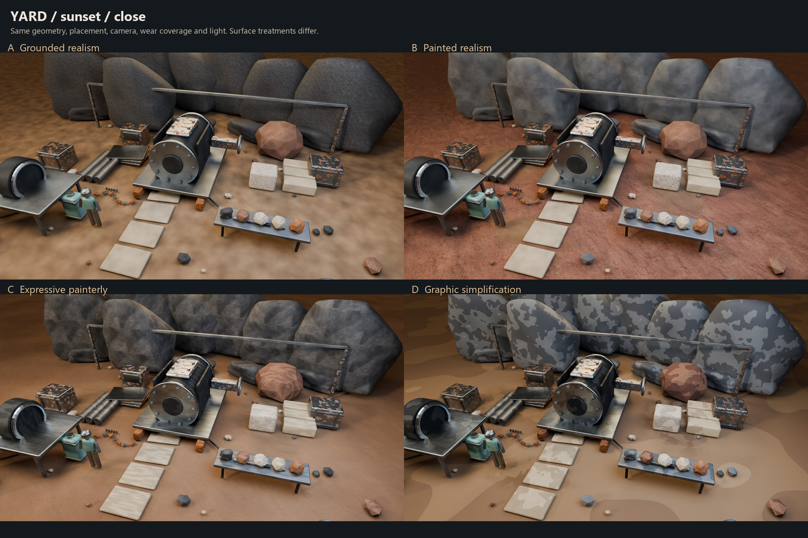

# Material diorama results

October 15, 2026. Sable. The author authorized implementation of the audited plan. The study is complete for visual comparison; selecting a treatment and approving production use remain the author's decisions.

Open [the comparison viewer](comparison.html) in a browser. It works as a local file without a server. Choose a place, light and view; click an image for full review resolution. [Workyard close comparison](boards/yard_sunset_close.jpg) is the best starting point, followed by the [form pilot](boards/whole_style_close.jpg) and [original B ground control](images/control_B_neutral_control_accepted_ground.jpg).

## Delivered

Three original dressed dioramas: salvage workyard, collapsed service gate and quarry relay cut. Machinery, storage, fasteners, sample benches, masonry, rubble, rock masses, dirt and gravel supply context around the material tests. They contain 177, 151 and 123 objects respectively, including shared study furnishings and the scale mannequin.

Four treatments span A grounded realism, B painted realism, C expressive painterly and D graphic simplification. These are original study interpretations of the researched visual principles, not reproductions of specific games or studios.

| Capture set | Images | Purpose |
| --- | ---: | --- |
| Common geometry | 72 | Three scenes × four treatments × two lights × three views |
| Neutral material plates | 12 | Metal, stone/ore and ground/ceramic groups for each treatment |
| Neutral full workyard | 4 | Check material separation without warm scene lighting |
| Accepted ground control | 1 | Original B panel beside its phase-blended derivative |
| Whole-style workyard pilot | 8 | Four treatments in gameplay and close views; C/D also alter forms |
| **Total primary captures** | **97** | 2560 × 1440 raw PNG; labelled review plates add caption margins |

The repository contains 97 review JPEGs, 25 boards/contact sheets, the viewer, scripts and evidence. Raw captures, four packed native Blender files and their backups remain local under the source policy. Review JPEGs preserve the rendered appearance; packaging only resizes, compresses and adds captions.

All fifteen conditions occur in every dressed scene and in neutral plates: clean processed metal, brushed metal, bare forged iron, blackened cast iron, partial rust, heavy rust, dense basalt, porous volcanic stone, granite, limestone, compacted dirt, loose fines, gravel, iron ore and ceramic. [Material graphs and coverage](material_manifest.json) map their IDs to actual objects. Ore is separate from metallic iron; rust uses oxide response rather than only an orange tint.

## Art review

**Recommendation: retain B's ground, use B as the material-response foundation, and borrow selected C accents for rocks and props.** This continues the author's earlier direction; the new implementations remain proposals.

- B gives the best quiet ground detail. The retained control shows the exact earlier atlas panel and grading; the new ground mixes two offset samples to soften repetition. This is a derivative, not an unchanged replacement. Loose fines and gravel are new extensions.
- C's broad rock variation reads well against the simpler floor. Its metal strokes help at close range, but applying that strength uniformly would make the scene busy. Keep the larger accents on exposed planes and selected hero props.
- A is a useful grounded comparison. Its dense, evenly distributed relief is less selective than the intended painted direction. It is a plausible procedural baseline, not a photogrammetry quality benchmark.
- D establishes an upper stylization boundary. Its quantized patches resemble camouflage, especially on large rocks and ground. I do not recommend this treatment for the desired realism, and it does not establish a faithful Risk of Rain 2 style.
- Metal reflection and oxide coverage remain readable in the neutral plates. Some partial-rust surfaces look like chipped light paint; future production authoring should give exposed iron, oxide depth and edge wear more specific construction logic.
- Granite grain is too evenly bright, porous volcanic pits are too regular, and repeated rock masses expose the study kit. These are material and composition tests, not finished environment assets. The sparse rear views are secondary continuity checks; use close views and plates to judge texture.
- Twilight keeps silhouette and major material separation but suppresses fine detail. Neutral diagnostics are included so those losses do not get mistaken for successful texture simplification.

Visual inspection covered every primary frame through the five contact sheets, plus larger workyard comparisons, the whole-style close board, repaired orbit board, neutral workyard and C metal plate. This is not a claim that all 97 images received individual full-resolution art review.

## Audit closure and verification

| Audit concern | Implemented evidence |
| --- | --- |
| Material-only comparison cannot prove whole-style direction | Separate eight-frame form pilot; A/B common forms, C broad-plane consolidation, D further facet reduction and selected housing proportion changes |
| Earlier B ground may drift | Original source pixels, panel bounds and grading retained; aligned paired diagnostic control |
| Small surfaces unreadable from gameplay distance | Twelve labelled neutral plates with equal flat/bevelled and curved coupons; three material groups |
| Camera comparison may be arbitrary | Eighteen matched four-style groups; serialized camera proxy checked within 0.000001 tolerance for float serialization |
| Dramatic lighting may conceal differences | Fixed exposure, both scene lights, four neutral full-scene diagnostics and numeric lighting manifest |
| Native files may lose dependencies | Packed-image reopen, all sixty material candidates retained, source/native hashes and actual reproduction render |

[Packaging verification](verification.json) checks the complete matrix, unique frame keys, raw hashes, image dimensions, fifteen-family coverage in each scene, common geometry fingerprints, matching cameras/resolution across all eighteen controlled groups, original source hashes and all four sealed native file hashes.

[Native verification](native_verification.json) reopened a fresh scratch copy of the sealed main file: 74 retained materials including helpers, six packed images and 483 mesh checks. No loose vertices, nonmanifold junctions or unintended open boundaries were found in the controlled source; ground/deposit boundaries are intentionally open. This topology check does not certify the separate C/D pilot as optimized production geometry. The [material manifest](material_manifest.json) preserves node parameters, ramps, links, object coverage and topology results.

The saved B workyard source reproduced its original sunset gameplay capture with maximum channel error **1/255** and mean absolute RGB errors below **0.00006/255**. It is not byte-identical; this is a near-identical pixel comparison on this machine, not a guarantee across Blender versions or hardware.

The viewer was exercised through all 25 selector groups: all 97 image elements loaded successfully. The [browser check record](viewer_verification.json) lists them. No Unity or gameplay smoke tests were run. The production scene, terrain, packages and runtime settings were not changed.

## Reproduction and limits

Use the installed Blender 5.2.2 LTS in background mode. Final captures use Cycles OptiX on the RTX 3060 Ti, 40 samples, denoising, AgX Medium High Contrast and exposure zero. Commands take the checkout root after `--`; paths must be quoted. Run in this order:

1. `blender.exe --background --factory-startup --python-exit-code 1 --python <task>/tools/build_study.py -- <root>` builds all captures and intermediate native files.
2. `blender.exe --background --factory-startup --python-exit-code 1 --python <task>/tools/seal_native.py -- <root>` retains zero-user material variants and packs all four native sources. This required step repairs Blender's omission of unassigned candidate materials; it preserves active assignments.
3. Open the sealed `MaterialDioramas.blend` in background with `--python-exit-code 1 --python <task>/tools/repair_orbits.py -- <root>`. It recaptures 24 orbit frames with a 4000 m background apron below the original floor and a 5000 m far clip. This removes the visible stage edge. Camera poses, foreground and shared within-group lighting remain fixed. The apron is created by this script, not saved in the main native file. Other views retain the original stage.
4. Copy the sealed main file to the raw output's `reopen/MaterialDioramas.blend`; open that scratch file in background with `--python-exit-code 1 --python <task>/tools/verify_native.py -- <root>`. This writes the native reproduction and manifests. Compare reproduction pixels with the referenced capture; retain measured errors in the verification record.
5. Run Python `tools/package_study.py <root>` with Pillow available. It refuses incomplete/mismatched raw evidence and writes review images, boards, receipt, verification and viewer. For inspection only, `verify_native.py` also supports `--inspect-only`.

Native sources: `SourceArt/Blender/Studies/Sable/MaterialDioramas20261015/`. Raw output: `outputs/Sable/MaterialDioramas20261015/`. The latter has a narrow local Git exclusion; native sources follow the existing local-only rule. The committed [render receipt](render_receipt.json) records source and native hashes, geometry/cameras and each primary capture. Original source atlases and the reused basalt FBX remain unmodified.

The authored gameplay camera proxy uses 22 m distance, 50° pitch, 40° yaw, 1.15 m target height, 48° vertical FOV and 16:9 output. Runtime camera preferences, collision/obstruction, look-ahead and riding states are not reproduced. No Unity import, shader equivalence, runtime performance or terrain integration is proven. World identity, streaming, generated-object identity and persisted deltas are not applicable because these are offline authored studies with no runtime system; the always-loaded production terrain is untouched.

The [lighting manifest](lighting_manifest.json) records one capture-order limitation: the whole-style pilot retains a white rim light after the neutral diagnostics, while the controlled scene comparisons use a warm rim. All four candidates within each set share the same light. Compare styles within a mode; comparing controlled versus pilot is not a geometry-only experiment.

Materials combine original procedural graphs and selected earlier generated B/C texture drafts. They are not manually hand-painted textures. The original atlas sampling, bounded geometry kit, one-frame native reproduction and offline renderer constrain what this study proves. The next creative decision is which B/C characteristics to retain, rather than accepting any complete candidate automatically.
