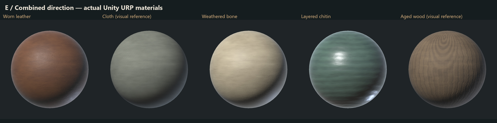

# Organic material library and comparison study

October 15, 2026. Sable. The author requested worn leather, cloth, bone, chitin and aged wood in the endorsed E direction, and specified high-quality, game-ready textures that are easy to use in Unity.

**Delivered: five material families, three treatments each, twenty-five seamless 2K PBR maps and fifteen ready-to-assign URP/Lit materials.** These are original authored procedural materials baked to ordinary textures. No external asset purchase, new image generation, custom runtime shader or package dependency is required.

**Lore correction, October 15:** technical Unity readiness does not establish game suitability. Wood and cloth are excluded from the game palette, rather than awaiting availability decisions. Keep their existing studies as historical references only. Continue with chitin and the game's scarce hide allowance; bone remains an anatomy-dependent candidate. See [lore alignment](LORE_ALIGNMENT.md) for the verified source records and boundaries.

Open [the comparison gallery](review.html). The [overview](E_overview.jpg) and five comparison boards show actual imported Unity URP materials. Additional Blender views show flat, curved and simple context forms. All variants within a family share the same normal, roughness/smoothness and cavity response; only the painted color treatment changes. R is restrained realism, E continues the working combined direction, and P tests broader painted accents. They are comparison candidates, not three new approved directions.

## Use in Unity

1. Open `Assets/_Project/Materials/SurfaceLibrary/OrganicLibrary20261015/` in the Project window.
2. For lore-compatible development, start with `Chitin_E`; `WornLeather_E` is a candidate for the game's extremely scarce processed hides. `Bone_E` needs species/anatomy qualification. Do not use `Cloth_*` or `AgedWood_*` in game content. The retained files are technical comparison references. Drag an appropriate material onto a UV-mapped mesh or assign it to its renderer; R/P alternatives are beside each E material.
3. Use the material's Base Map tiling to control density. One UV tile is authored as a nominal one-metre material patch; the mesh's UV layout determines its actual world scale. Keep tangents and UVs on the target mesh. Wood grain runs along V; rotate the mesh UVs to align it with a board or handle.

Materials use stock **Universal Render Pipeline/Lit**, opaque metallic workflow, with instancing enabled. The set is imported and rendered in the pinned Unity **6000.4.0f1**, URP **17.4.0** project, on the StandaloneWindows64 target. Existing scenes, renderer assets and packages were not edited by this task.

Textures are under `Assets/_Project/Art/Textures/OrganicLibrary20261015/`. Every family has five 2048 × 2048 PNG files:

| File suffix | Contents | Unity setting / slot |
| --- | --- | --- |
| `BaseColor_R`, `BaseColor_E`, `BaseColor_P` | Unlit material color variants | sRGB; Base Map |
| `Normal` | Tangent-space +Y/OpenGL normal | Normal Map importer; green flip off; Normal Map slot |
| `Mask` | R: metallic 0; G: intrinsic cavity occlusion; B: reserved 1; A: smoothness | Linear; assigned to both Metallic Map and Occlusion Map |

URP smoothness is set to 1 so the mask's alpha supplies the full smoothness value. Smoothness source is Metallic Alpha, not albedo alpha. Occlusion uses the same packed image's green channel. These dielectric materials have no exposed metal. Texture wrap is Repeat, filtering Trilinear, anisotropy 8, mipmaps enabled (12 levels), maximum size 2048 and CPU readability disabled. Standalone overrides use BC7 for color/masks and BC5 for normals. There is no displacement, parallax, alpha cutout, cloth simulation, subsurface scattering, anisotropic shader extension or special chitin shader to configure.

Variants share maps to avoid duplicating physical detail. All twenty-five textures loaded for the complete comparison library report about **167.7 MiB** through the Editor's runtime-memory API on this machine, including engine/driver accounting. This is not a player GPU profiling result or a per-material cost. Only referenced textures need to ship/load; unused R/P variants need not be included in a final scene. Smaller target budgets can use per-platform import resolution overrides after target-specific review. Mobile compression and console performance have not been qualified.

## Material character and art review

| Family | Authored surface | Review |
| --- | --- | --- |
| Worn leather | Fine grain, crease networks, worn pigment and roughness variation | E keeps the grain legible with soft broad color variation. Local edge wear, stitch lines and large tears should be authored for the specific prop rather than repeated in a generic tile. |
| Cloth | Dense weave/twill relief and gentle dye variation | E keeps the weave readable; P offers more obvious color grouping. This is opaque cloth reference, not loose-thread geometry, fraying or a fabric-simulation asset. |
| Bone | Warm mineral color, fine pores and directional surface variation | E is the best general base; P's broader strokes can suit larger pieces. Exposed cancellous interiors and broken ends need separate textures/geometry. |
| Chitin | Layered growth bands, fine surface detail and a stronger polished response | The family separates clearly from hide and bone. E retains layered color while keeping the surface grounded; P is a more decorative proposal. Shell segmentation and chipped edges remain mesh-specific. |
| Aged wood | Irregular grain frequencies, elongated knot fields, splits and desaturated weathering | The initial uniform grain was replaced after review. E now gives a stronger wood reading with softer color groups than R. End grain and individual plank damage remain separate future variants. |

All five Unity comparison boards, the E overview, representative larger Unity images and Blender flat/context views were inspected. E is the recommended starting set; the more painted P versions remain useful boundaries. The differences are intentionally selective color changes, not wholesale replacements of surface response. These tiles are reusable material bases: they do not encode every condition or replace asset-specific wear authoring.

The author's subsequent correction makes wood and cloth excluded materials, not open availability questions. Hide processing has extremely low yield; chitin and husk-derived materials are recognized. Generic bone needs anatomy qualification. The initial study should have applied these constraints before texture authoring. Retaining existing comparison files does not authorize their use or establish new species anatomy or crafting recipes.

## Verification and scope

- [Texture validation](texture_validation.json): all 25 delivered maps match baked source hashes, are 2048 × 2048 RGBA, have valid packed channels and near-unit normal vectors. Forty asset/meta pairs have unique GUIDs, with no matching GUID elsewhere in Assets.
- [Wrap analysis](seam_analysis.json): every map's wrap-edge average step passes a bound of 1.6 times its interior adjacent-pixel average plus 0.1/255. The graphs use periodic coordinates; tile endpoints are adjacent texel centres, not duplicate border pixels. Five 2 × 2 color repeats are available in the gallery.
- [Unity verification](unity_verification.json): actual imported resolution, twelve mip levels, BC5/BC7 formats, color space, normal convention, texture references, packed-map settings, required keywords and supported URP shader without reported shader errors, for all fifteen materials.
- [Delivery manifest](delivery_manifest.json): hashes for forty runtime assets, their forty metadata partners and four new folder metadata files. Unity-generated empty YAML values retain their serializer's trailing spaces; no metadata was regenerated for formatting.
- [Review verification](review_verification.json): source hashes and fifteen actual Unity preview frames, with no blank or magenta error frames, plus fifteen Blender frames and forty-six review derivatives.
- [Native verification](native_verification.json): saved `.blend` hash, twenty-five packed image dependencies, five editable authoring materials, fifteen baked review materials and a rendered frame after reopening.

The native reopen render differs from its reference by at most one 8-bit channel value. The gallery was checked in the background browser: all six displayed images load, with readable comparison layout and working local asset paths.

Unity imports and offscreen captures used the existing Editor in stable Edit Mode through Pipeline's guarded `run_script`, without focusing its window. The capture utility uses a private preview scene and transient meshes. It does not enter Play Mode, save/open the author's scene, or change its existing dirty state. No gameplay smoke tests, player build, production placement or runtime performance test were run.

Deterministic world identity, chunk streaming/unload, generated-object identity and persisted deltas are not applicable: these are reusable surface assets and private study forms, with no runtime generation or saved objects. Authored constraints are preserved by leaving the fixed production terrain and all production material assignments unchanged.

## Sources and reproduction

Editable source: `SourceArt/Blender/Studies/Sable/MaterialDioramas20261015/OrganicLibrary.blend`, local only. Raw bakes/renders and previous wood-map recovery copies remain local under `outputs/Sable/MaterialDioramas20261015/OrganicLibrary/`, covered by the existing narrow local exclusion. Native source and backups follow the repository's local-only policy. Runtime texture/material assets and their Unity-generated metadata are tracked.

`build_library.py` runs through the installed Blender 5.2.2 LTS in background mode with `--factory-startup --python-exit-code 1 --python <script> -- <checkout-root>`. It authors the graphs, bakes colors/normals/packed masks, renders shared test forms and saves packed source. Optional `--family AgedWood` revises only wood outputs and retains the other families' receipt entries; a full clean run omits this argument. No image is manually painted or sourced from a third-party library. Scalar smoothness is baked separately and copied verbatim into mask alpha; no painted image is retouched.

`UnityLibrary.cs` is an ephemeral editor tool outside Assets. Compile it through Pipeline `run_script --file <file> --entry SableOrganicLibrary.Import --args '["WornLeather"]'` for each family, with the project root explicit and a 50000 ms dispatcher budget. It requires stable Edit Mode, refuses differing existing texture bytes, configures only its assets, and saves only task materials. `Validate` writes Unity evidence; `Capture` renders each family's three materials in a private preview. `UpdateWood` is a one-time revision operation guarded by the previous five owned texture hashes; it must refuse once those bytes have changed. `FinalizeFolder` was a one-time GUID-preserving move away from the repository's recursively ignored `Library/` name; current reproduction imports directly into `SurfaceLibrary/`.

Run `verify_native.py` through background Blender to reopen/check the source, then Python `validate_library.py <root>` and `package_library.py <root>` to check delivery and create review artifacts. Python packaging only resizes/compresses/captions images and lays out repeated tiles. Preserve the original receipts if reauthoring a new revision; do not silently overwrite accepted textures or user-edited materials.
