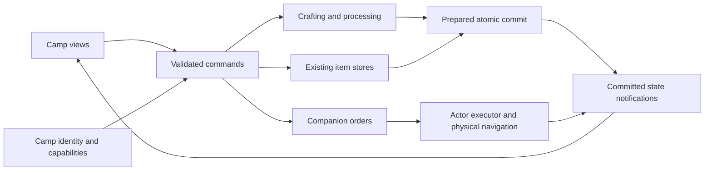
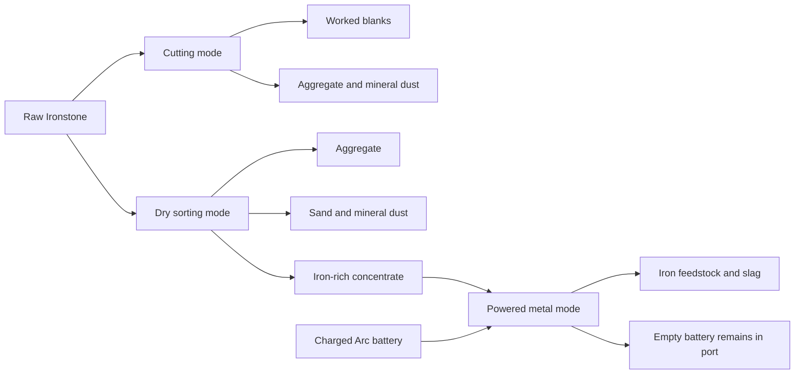

# Camp system skeleton and Ironstone refinery — audit and brainstorm

October 14, 2026. **Design proposal only.** The author wants camp to become a major mechanic for item management, crafting and companion NPC management, developed incrementally in Camp Loop. This document audits the existing seams and proposes a foundation and another refinery. It authorizes no gameplay, scene, package or save-format changes.

## Recommendation

Treat camp as an identifiable physical **site with capabilities**: storage, crafting, processing, rest and companion coordination. Each capability retains its own state authority. Camp provides discovery, access rules and coordination; it does not become another inventory, another NPC motor or one controller that implements every mechanic.

The proposed Ironstone station starts as a **dry crusher and separator**, with cutting and powered metal-processing modes added deliberately. Start with one deterministic, manual sorting batch and a local output tray. A later powered mode can connect the existing Arc battery loop to useful metal feedstock. Defer queues, offline production, autonomous companion labor and an extensive material catalog until their individual slices are needed.

## Scope and truth boundaries

- [World basis](../../WORLD_BASIS.md) controls the setting: dry world, algae-based survival, vulnerable Booter and a physically present Legger. Camp is not automatically safe. No washing plant, open-water coolant, wood fuel or remote companion storage is assumed.
- The user now asks for management of companion NPCs. That establishes the design direction; it does not establish recruitment rules, a roster size, companion abilities or camp safety. The existing Lager enemy is not automatically a recruitable companion.
- The [Legger standard](BIGARM_COMPANION_STANDARD.md) preserves finite physical cargo and real travel. A management screen cannot teleport him or use inaccessible cargo. Orders and status inspection are distinct from item access.
- The workstation baseline is committed at `d91cd4b87`; [its receipt](../../Evidence/Gameplay/CampWorkstations20261014/README.md) records 177 passing focused checks. Those are retained implementation evidence, not new tests performed by this audit.
- Inspection began at that baseline and continued while riding, animation and optics work changed the shared checkout. Riding dispatch/scene work is concurrent and must be reconciled before any later implementation. No shared source or scene is edited here.
- The external Arc & Dust lore checkout is not connected on this machine. New material names, ore composition, yields, power costs and crafting uses below are proposals, not recovered lore or accepted canon. This is a game-economy sketch, not a metallurgical simulation or a real-world processing specification.

## Current architecture audit

| Surface | What exists | Implication for a larger camp |
| --- | --- | --- |
| Portable rest | [CampController](../../../Assets/_Project/Scripts/Runtime/TopDown3D/Camping/TopDown3DCampController.cs) and [CampState](../../../Assets/_Project/Scripts/Runtime/TopDown3D/Camping/TopDown3DCampState.cs) own placement, setup, rest/sleep, recovery and packing; a deployed record gets a GUID. | Keep this as the rest/shelter capability. Packing a shade must not despawn an entire workshop or its stored goods. |
| Authored camp/return | [WaypointCampController](../../../Assets/_Project/Scripts/Runtime/TopDown3D/Camping/TopDown3DWaypointCampController.cs) owns the authored site and return behavior. | Reconcile site identity and capability membership instead of adding a competing camp location authority. Portable shelter and fixed workshop need distinct profiles. |
| Lab economy | [EconomySession](../../../Assets/_Project/Scripts/Runtime/TopDown3D/Camping/TopDown3DCampLoopEconomySession.cs) binds one kit, cargo, chest, bench and dust refinery, seeds one recipe and checks canister ownership. | Useful bootstrap/proof boundary; hard-coded owner indices and one refinery are not a general camp registry. Keep lab grants separate from normal camp construction. |
| Items and storage | [InventoryState](../../../Assets/_Project/Scripts/Runtime/TopDown3D/Inventory/TopDown3DInventoryState.cs), [policy](../../../Assets/_Project/Scripts/Runtime/TopDown3D/Inventory/TopDown3DInventoryPolicy.cs) and catalog own stacks, equipment identity, legal slots, payloads and mass. | Reuse them. A camp summary is a view of stores, not a pooled inventory with duplicated counts. Current owner enum has Booter, BigArm and ResourceCache only; station buffers need a deliberate policy. |
| Crafting | [CraftingRecipe](../../../Assets/_Project/Scripts/Runtime/TopDown3D/Camping/TopDown3DCraftingRecipe.cs) supports multiple ingredients but one output; [CraftingService](../../../Assets/_Project/Scripts/Runtime/TopDown3D/Camping/TopDown3DCraftingService.cs) reads one source, writes one different destination and commits atomically. | A material separator needs several outputs. Multi-source consumption, same-store processing and recipe browsing are not currently implemented. |
| World/item commit | [Transactions](../../../Assets/_Project/Scripts/Runtime/TopDown3D/Inventory/TopDown3DInventoryState.Transactions.cs) support revision locks and [prepared world participants](../../../Assets/_Project/Scripts/Runtime/TopDown3D/Inventory/TopDown3DPreparedWorldMutation.cs), with state installed before notifications. | This is the foundation to extend. New processing must not use a commit condition to mutate a battery or emit byproducts; those belong in prepared state installation. |
| Station UI | [Workstation controller](../../../Assets/_Project/Scripts/Runtime/TopDown3D/UI/TopDown3DCampWorkstationUiController.cs) shares input/menu ownership but switches among specific bench/refinery/cache types and three owners. Its canvas is laid out for up to 24 slots. | Add a bounded station capability/command adapter when introducing the third station. More storage needs scrolling/pages, contextual defaults and searchable projections, not ever-larger hard-coded grids. |
| Companions | [BigArmState](../../../Assets/_Project/Scripts/Runtime/TopDown3D/BigArm/TopDown3DBigArmState.cs) has identity, position and a string task; [follower](../../../Assets/_Project/Scripts/Runtime/TopDown3D/TopDown3DBigArmFollower.cs) has physical follow/call-over and bounded route recovery. [NPC actor](../../../Assets/_Project/Scripts/Runtime/TopDown3D/NPC/NpcActor.cs) serves a separate actor lane. | Identity/task fields are useful seams, not an implemented camp roster or work-order executor. Do not turn every NPC actor into a companion or promise long-distance camp orders from local follow behavior. |
| Reset | [InventoryTrial](../../../Assets/_Project/Scripts/Runtime/TopDown3D/Inventory/TopDown3DCampLoopInventoryTrial.cs) has one external blocker and one prepared reset callback; EconomySession composes the current refinery/device reset. | A second processor must join reset preparation and ownership validation. Replacing that single callback would omit the old refinery. Animation reset is sequential and is not an atomic economy reset. |
| Persistence/time | [Authored checkpoint](../../../Assets/_Project/Scripts/Runtime/TopDown3D/Persistence/GreaterWastelandInventorySnapshot.cs) stores one kit/cargo/cache and rest/device state. [SaveService](../../../Assets/_Project/Scripts/Runtime/TopDown3D/Persistence/GreaterWastelandInventorySaveService.cs) excludes the marked lab. [WorldSpeedController](../../../Assets/_Project/Scripts/Runtime/TopDown3D/Simulation/TopDown3DWorldSpeedController.cs) leases scaled world speed for rest. | Station inventories, power, jobs, multiple camp sites and roster orders are not a production checkpoint aggregate. Timed processing must eventually follow the shared simulation policy; a UI stopwatch or wall-clock catch-up is insufficient. |

Documentation drift matters: [the older mining system document](IRONSTONE_MINING_AND_INVENTORY_SYSTEM.md) still describes Booter resource fallback and a 16-slot kit. Current [destination routing](../../../Assets/_Project/Scripts/Runtime/TopDown3D/Inventory/TopDown3DItemDestinationService.cs) requires accessible Legger cargo for harvested resources, and the camp loadout has six equipment slots plus four supply pockets. Follow live code and the newer receipts when implementing this proposal. The old [formation mineralization plan](IRONSTONE_FORMATION_MINERALIZATION_PLAN.md) concerns a generated-world cutover, not authorization to change Camp Loop's twelve authored deposits.

### Main expansion risks

1. **Camp identity and membership:** one portable rest record, one waypoint site and one lab economy session do not yet define a general multi-site camp aggregate. Define membership and ownership before placing the same station prefab in several camps; its current default station ID cannot be reused globally.
2. **Multiple products:** adding sand or dust as a side effect after making the main metal product can lose or duplicate items on capacity/access failure. Every output must participate in the same commit.
3. **New stores and sockets:** the current ownership audit covers three carried stores, deployed canisters and one refinery. Add every new output buffer, power socket and future job owner to the audit/reset/save scope.
4. **Energy representation:** empty/charged battery item IDs do not encode numeric charge. Fractional power consumption, battery wear or several charge levels need a separate versioned model. A whole charged-to-empty transition is the only proposed early power abstraction.
5. **NPC execution:** a task string, roster row or claimed station cannot prove arrival, path reachability or work completion. Orders need an executor and interruption rules, with one movement owner per actor.
6. **Prototype economy dependencies:** the existing empty-battery recipe consumes four raw ore. Replacing it with processed metal is a separate design change. Existing salvage parts also have a conservation ledger; do not consume them for alloys without changing that ledger deliberately.

## Proposed camp skeleton

These are responsibility names, not a demand for all-new classes or a generic framework immediately.

| Part | Authoritative responsibility | Small first use | Later extension |
| --- | --- | --- | --- |
| Camp site record/profile | Persisted CampId, site transform, kind, authored constraints and enabled capabilities. | Identify the starting workshop and link its existing anchors. | Multiple sites, authored/outpost and player-created camps, construction/upgrades. |
| Capability registry | Resolve station/store/roster service by stable ID within a camp; reject duplicates. | Existing chest, bench and dust refinery plus the proposed processor. | Add a station without another parallel global manager. |
| Item/store access | Resolve the actual state owner and physical permissions. Counts remain in each inventory/socket. | Booter, reachable Legger, linked chest, local processor tray. | Multiple chests, filters, quantity transfers and explicit allocation across accessible stores. |
| Craft/process service | Validate a recipe and prepare inputs, all results and power before committing. | One deterministic sorting recipe; preserve current battery recipe. | Recipe library, equipment factories, selected batch counts, salvage/repair. |
| Companion roster/order service | Affiliation, capabilities and requested task; actor state/motor retain execution truth. | Read-only Legger status and the existing “Call Legger to Booter” command. | Wait/return-to-site, hauling and station work as separate verified actions. |
| Presentation/session owner | One active modal, focus, menu handoff and stale-command guards. | Contextual storage/crafting/processing views. | A camp overview with Items, Crafting, Processing and Companions sections. |
| Aggregate validation/reset/save boundary | Coordinate participants, versions and recovery without copying their contents. | A composable lab economy reset covering both refineries and all stores. | One validated camp/world checkpoint containing stores, sockets, jobs and roster orders. |

Keep the camp controller thin. Definitions/profile data are immutable authoring assets; inventories, station contents and orders are mutable records. UI may calculate **total known / accessible / reserved** stock separately, but “known somewhere” never means usable now. Future multi-store crafting needs an explicit, deterministic allocation list, not an invisible search through every companion's belongings.

Present a small camp overview with contextual station details rather than a factory dashboard immediately. Keep recipe requirements/results and blocked reasons visible. Opening management must not itself grant protection or stop world simulation. Commands should recheck actor life/action eligibility as well as proximity and item revisions; danger, disable or departure must close/intercept the appropriate interaction without deleting stored goods.

A fixed workshop profile can enable storage and processing. A temporary shade/rest profile can enable rest only. Deploying the current portable camp item must not grant chests, refineries, recruitment or free supplies. Construction and station relocation later require a separate packing rule: reject while contents/jobs are present, or transfer the entire packed instance with preserved identity and contents. Never delete a live station's tray when its visual is removed.

### Companion management seam

Start by showing the Legger's identity, actual location/proximity, availability and cargo access. “Call to Booter” is the existing action; do not label it “Return to this camp,” because it does not establish a persistent camp-anchor task.

A future order should identify the actor, target camp/station/store, intent and revision. Keep **intent** (haul ore) separate from **execution** (moving, working, blocked, interrupted, complete) and life/movement state. Reserve the worker/station only when the executor accepts; do not grant resources merely because the roster says “assigned.” A blocked route stays blocked, with a reason. Recall, danger, mounting, death/removal and station disable must explicitly interrupt/release ownership. Riding and worker actions cannot simultaneously command the Legger's motor.

Later hauling transfers an exact quantity from a real accessible source to the actor's real cargo, then to the destination after arrival. Both transfers use the same inventory commands as the player. The roster never owns a duplicate backpack, and a hauling order cannot manufacture transport capacity. Follow the [existing NPC architecture brainstorm](NPC_AND_GAME_AI_METHODS_BRAINSTORM_2026-10-14.md) before selecting AI packages or building a second behavior stack.

## Ironstone station brainstorm

Working functional name: **Ironstone Processor**. Its early identity is a compact dry-material station with a feed hopper, crusher/cutting mechanism, separation section and visible collection tray. A future power port belongs to the metal stage. This gives the new station a different silhouette and purpose from the Arc Dust refinery, whose two sockets handle a canister and battery.

### Material families and crafting purpose

| Proposed result | Role | Example use, subject to later recipe design |
| --- | --- | --- |
| Worked stone blank | A shaped, larger stone product, distinct from loose aggregate. | Tool blank, sharpening block, simple construction part. |
| Coarse stone aggregate | A crushed stone product. | Packed bases, heavy ballast, coarse abrasive recipes. |
| Mineral sand | A finer granular product. | Fine abrasive, packing/filler, later filter or mould recipes if supported by world materials. |
| Mineral dust | The finest ordinary material fraction. | Powder/filler and later composite recipes. **Not Arc Dust and not an energy source.** |
| Iron-rich concentrate | An intermediate that gives metal processing its own step. | Input to the powered metal mode. |
| Iron feedstock | First metal product; exact form/name remains open. | Metal fittings and later equipment/battery recipes. |
| Slag/grit | Accounted-for metal-stage remainder. | Low-grade filler or a later explicit reclaim/discard action; never automatically disappear. |

More stone families should have a distinct recipe purpose or require a different source material, rather than create several cosmetic stacks from one ore. For later metals, distinguish **other base metals** from **grades/alloys made from iron**. Tough alloy feedstock and conductive metal/alloy are possible future branches, but their composition and additional ingredients need author direction. A single unassayed Ironstone item does not currently establish copper, nickel, precious metals or every alloy ingredient. Use distinct source/assay item definitions later if those branches become desirable.

### Processing modes and illustrative yields

The following numbers are **test hypotheses only**, chosen to make item/mass accounting inspectable. Current raw ore mass is **1.25 per unit** in [Item_IronstoneOre](../../../Assets/_Project/Settings/Items/Item_IronstoneOre.asset). Proposed result masses: worked blank 1.5, aggregate 0.75, concentrate 2.0, sand 1.0, mineral dust 0.25, iron feedstock 0.75 and slag 0.5.

| Mode | Proposed input | Proposed complete result | Mass check | Sequence |
| --- | --- | --- | --- | --- |
| Dry sorting | 4 raw Ironstone | 2 aggregate + 1 concentrate + 1 sand + 2 mineral dust | 5.0 -> 1.5 + 2.0 + 1.0 + 0.5 = 5.0 | Recommended first experiment. |
| Cutting | 2 raw Ironstone | 1 worked blank + 1 aggregate + 1 mineral dust | 2.5 -> 1.5 + 0.75 + 0.25 = 2.5 | Alternative use for raw ore, added after the first batch works. |
| Powered metal processing | 1 concentrate; a charged battery in the power port | 2 iron feedstock + 1 slag; battery becomes empty in its port | Material 2.0 -> 1.5 + 0.5 = 2.0; battery's 0.8 mass remains | Follow-up experiment connecting the two refinery loops. |

Counts describe abstract item units, not equal-sized rocks or measured chemical fractions. For the new separation recipes, output mass should not exceed accounted input mass, and every loss/byproduct must be explicit. Do not impose this new separation rule on all existing crafting recipes: the current four-ore-to-one-battery recipe already abstracts processing/waste and is intentionally preserved here.

Dry sorting is proposed as manually operated, with no power consumption in its first test slice. This is an economy simplification, not a claim that the later machine runs for free. The future powered mode's whole-battery-per-batch cost is also provisional; partial discharge would require changing the battery data contract. No water, oxygen drain, fuel, coolant or additional survival cost is silently added.

The routing is:

### First interaction and ownership contract

Recommend an **eight-slot local output tray** as a provisional buffer, using the existing inventory implementation with a validated station-resource policy. It is a fourth physical store, not fake Legger cargo. The first slice need not own a separate feed inventory: it consumes a confirmed batch from one selected, reachable cargo/chest source and places every result into that tray atomically. The hopper mesh can be presentation until an actual input-buffer feature is requested.

1. Reach the processor; choose its available mode and one physical source. Raw ore and all proposed material products remain Resource items, carried by Legger or local storage; Booter's equipment/supply kit is not a mineral backpack.
2. Show required ore, complete output bundle, accessible source amount and output room. Preview is read-only. Batch count starts at one; no silent “process everything.”
3. On confirmation, prepare removal of all input and admission of **all** outputs. Check stack limits, slot capacity, mass, actor access, station identity/revision and any power-port state. Deduplicate participating stores and use one draft per authority.
4. Install the inventory and station/power changes together, then publish feedback. If any result cannot fit, nothing is consumed, no battery is discharged and no product is emitted. Check arithmetic overflow when multiplying batch quantities.
5. The tray retains products when UI closes or cargo leaves. Take a selected stack/quantity into a legal accessible destination through normal transfers. A future “Take All” must define whether it is atomic; recommend all-or-nothing with a visible reason when it cannot fit.

The source and tray are different owners in this slice, matching the existing craft service's separation. Same-store input/output should be an intentional later extension, coalesced into one draft, rather than two mutations locking the same inventory.

The power port, when added, owns the inserted battery just as the existing refinery socket does. Return-empty behavior must be part of the same commit and preserve the port contents. A failed output check must not turn the charged item into empty. Mineral dust never enters an Arc canister or charges a battery merely because its display name contains “dust.”

### Data and extension seams

- Use a versioned process definition with station capability, accepted input IDs, a complete list of output IDs/quantities, and optional power transition. Either extend the existing recipe representation compatibly or share its validated ingredient/result records; do not build an unrelated item catalog/transaction engine.
- Keep the existing single-output battery asset valid. Do not remove or reinterpret its serialized fields during a multi-output migration. Equipment outputs still need canonical instance creation and explicit initial payloads, especially for canisters.
- Extend the same private Camp Loop loadout profile/catalog resolution. New proposed IDs such as `lab.ironstone.aggregate`, `lab.ironstone.concentrate`, `lab.ironstone.sand` and `lab.ironstone.mineral_dust` would be lab-only initially; these strings are not created or canonized by this document.
- Keep product grades as separate item definitions first. Avoid introducing per-stack randomized purity, quality or composition payloads before their stacking, migration and crafting rules exist.
- No queue or long-running job is needed for instant batches. Later timed jobs need persisted job IDs, frozen recipe version/results, input ownership or reservations, power ownership, output capacity/reservations and exactly-once completion. UI reopening never restarts a job or rerolls its yield.
- Later processing/sleep/NPC work must advance on one simulation policy. Do not use an independent unscaled UI timer or wall-clock offline progress. Pause/focus, station disable, danger and output blockage need explicit behavior before timed jobs are introduced.

## Camp Loop integration and preservation requirements

This proposes future construction **in CampLoopTesting**, not production promotion. Place the processor on a surveyed native-terrain point in the starting workshop area, with an approach, loading side and Legger parking clearance. Survey the current scene after riding integration; this audit does not assign coordinates or move a station. Keep the existing chest and two workstations rather than replace them.

| World concern | Proposed contract |
| --- | --- |
| Deterministic world identity | Use the existing fixed authored-world identity. Camp Loop's marked scene is the lab scope; no new terrain seed/generator is needed. Keep placement identity distinct from checkpoint/schema identity. |
| Stable site/station/store identity | Persist site identity and scope local station/store IDs under it. One authored processor ID for the first lab; duplicate registration fails closed. A future player-created camp receives a persisted GUID once, not a new ID every load. Never derive ownership from scene object names/load order. |
| Terrain streaming | Not applicable in this slice: native terrain is fixed and resident by user direction. Do not activate retired terrain streaming. Future view unload/reconstruction must bind back to retained camp records, not recreate stocked inventories or duplicate workers. |
| Authored constraints | Preserve terrain/colliders, existing twelve ore nodes and depletion IDs, seven rocks, shelter/return routes, actors, salvage, NPC, AP01–AP12, riding fixtures, camera/rendering, the existing cache/prefab/catalog GUIDs and build routing. |
| Runtime deltas | Track processor tray and later power/job state, camp membership and deliberate reset epochs. Lab/domain reload continuity must not become an unapproved production disk-save rollout. |
| Production checkpoint | Current aggregate omits both refinery economies and roster jobs. A later production slice must version and validate the full graph before restore, preserve recovery data, and prevent partial inventory/station restoration. Do not install the old generated-world save service. |

The current chest seed contains exactly the raw ore for one empty battery. Leave it alone. Processor trials should initially use ore from the existing authored deposits, delivered through accessible Legger cargo. If a separate processor test seed is later approved, own/version it explicitly; do not reseed the chest on opening a processor or resetting another subsystem.

The current economy reset replaces all chest ore matching its recipe input. That would also affect processor feedstock of the same ID. Define reset scope before adding the station: recommend one explicit coordinated **camp economy trial reset**, with the processor tray/power owner included and clear disclosure of which raw ore/products are removed/restored. Keep salvage rewards/depletion, animation resets and actor/vitals resets separate unless an explicit full-trial command intentionally includes them. Compose blockers/prepared participants instead of overwriting the inventory trial's single callback. An occupied new tray or power port must never be ignored by an old reset or dropped during reconstruction.

## Incremental direction, not an implementation authorization

| Slice | Goal | Deferred |
| --- | --- | --- |
| Camp foundation | Resolve site/capability identities, item-owner registration and composable validation/reset without duplicating existing authorities. | Construction tiers, recruitment, global management or production save migration. |
| Dry processor experiment | One authored processor, one sorting recipe, complete multi-output commit, local tray and ordinary transfers. | Fuel, timers, queues, purity rolls, automatic labor, battery-recipe redesign. |
| Material variety | Add cutting and a small set of consuming crafting recipes so products have distinct use. | Large catalogs and cosmetic grades that only clutter storage. |
| Powered metal experiment | Explicit charged-to-empty port transition and metal/remainder outputs; tune costs separately. | Fractional energy, battery wear, multiple base metals without defined ore sources. |
| Companion management | Status/call first, then one physical hauling or station-work action with cancellation and blocked-path feedback. | A full scheduling AI, unattended factories or instantaneous remote work. |
| Production integration | One validated persisted aggregate with migrations and failure recovery. | Automatic promotion from a successful lab session. |

Before a later implementation, gates should cover complete-bundle output failure, input/access loss, simultaneous transfers, repeat/held commands, integer/mass bounds, duplicate owner/operation IDs, typed resource restrictions, all-owner reset, recipe-version change, malformed snapshots, disable/reload continuity and preserved existing battery/salvage/canister behavior. For future jobs/companions, add interruption, route blockage, recall/mount conflict, worker/station removal and save-between-start-and-completion checks. No gameplay smoke tests are proposed without the author's explicit request.

Open creative choices are the final material names/composition, whether concentrate is desirable as an intermediate, meaningful uses for sand/dust/slag, powered-stage cost, and how many companion roles belong in camp. The recommendation above supplies a coherent starting point without deciding all of them now.

## Audit closeout

Source and document inspection only. No Unity launch, compilation, scene authoring, runtime/asset/package edit, gameplay test, external lore retrieval or publication was performed. Proposal links and illustrative mass arithmetic are checked as document validation. Prior implementation evidence is cited with its own scope; it is not promoted to new proof for this unbuilt processor.
