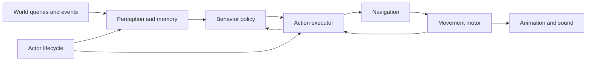

# NPC and game AI methods brainstorm

October 14, 2026. This continues the [first legger audit](CAMP_LOOP_LEGGER_ENEMY_AUDIT_2026-10-14.md). The immediate proving ground is one skittish enemy in CampLoopTesting. Broader methods below are proposals, not accepted enemy taxonomy, implementation or new world canon.

The [first Lager enemy implementation plan](CAMP_LOOP_LAGER_ENEMY_IMPLEMENTATION_PLAN_2026-10-14.md) turns the first stage into a bounded build sequence with tunable behavior and explicit validation.

Recommend a layered system: explicit lifecycle and behavioral states, scored choices where alternatives matter, reusable action execution and replaceable navigation. Prove the small version through the legger before introducing visual graph tooling, a planner, squads or population simulation. Robustness means the actor behaves coherently, respects world rules, fails safely, costs bounded work and can explain its decisions.

## What robust should mean for this game

An NPC should never walk through a rock to satisfy an AI decision, receive hidden knowledge accidentally, teleport out of trouble or lose its identity when its visual disappears. A trapped skittish legger may fail to escape; that is a valid situation. Replanning forever, jittering between directions or inventing an attack to escape is a system failure.

The architecture must also let us answer why an actor acted: what it perceived, which options were legal, what it chose, who owned execution and what prevented progress. A larger algorithm cannot compensate for missing those contracts.

Keep responsibilities within the active TopDown3D assembly initially. A responsibility boundary does not require a new assembly, singleton or configurable framework. The [world architecture baseline](../../Engineering/GREATER_WASTELAND_WORLD_ARCHITECTURE_BASELINE_2026-10-11.md) already separates logical identity, mutable state, scheduling, presentation and checkpoint ownership; NPCs should follow those boundaries.

## Compare decision methods

| Method | Useful when | Main design cost | Fit for the legger |
| --- | --- | --- | --- |
| Explicit finite states | A few readable modes and known transitions | Transitions multiply as unrelated concerns enter the same state list | Best starting point for Idle, Alert, Retreat, Flee and Recover. |
| Hierarchical states | Several modes share entry, interruption or cleanup rules | Parent/child entry order and simultaneous concerns need precise semantics | Add a shared ThreatResponse parent when it removes actual repetition. |
| Behavior trees | Reusable sequences and fallback tasks matter across several actors | Running tasks need cancellation and clear reevaluation rules | Later task authoring option; excessive for the first five-mode behavior. |
| Utility scoring | Several eligible goals or positions compete by degree | Scores need comparable scales, diagnostic breakdown and switching control | Use first for escape candidate selection, later for competing motives. |
| Goal oriented action planning | An actor must compose different action chains to achieve a goal | Preconditions/effects, search budgets and invalidation become another model to maintain | Defer until a requested enemy needs alternatives such as obtaining a tool or opening a route. |
| Authored task sequences | A specific encounter or interaction must follow known steps | Sequences need fallback, reservations and interrupt handling | Good for future scripted patrol/ambush tasks; do not hardcode all free behavior into a timeline. |

These methods can cooperate. Epic's [StateTree overview](https://dev.epicgames.com/documentation/en-us/unreal-engine/overview-of-state-tree-in-unreal-engine) describes a state hierarchy combined with selector/task concepts. That is a conceptual reference, not a reason to reactivate Unreal. Unity's [Behavior package](https://docs.unity.com/en-us/engine/6000.3/manual/packages-list/packages-all/pack-safe/com-unity-behavior) provides modular behavior graphs and reusable subgraphs. Its [observer interruption documentation](https://docs.unity3d.com/Packages/com.unity.behavior@1.0/manual/observer-abort.html) illustrates higher-priority branches interrupting lower-priority work.

[Graham's utility chapter](https://www.gameaipro.com/GameAIPro/GameAIPro_Chapter09_An_Introduction_to_Utility_Theory.pdf) presents action scoring and inertia. [Orkin's F.E.A.R. paper](https://www.gamedevs.org/uploads/three-states-plan-ai-of-fear.pdf) presents planning alongside a small execution state machine. Our proposed fit and sequencing are design judgments: neither source establishes that its method is the best architecture for this game.

The live manifests have no Behavior, Entities or AI Navigation package entries. Retain existing package pins. A future graph-tool evaluation must test the exact Unity version, interruption behavior, serialization, debugging and our motor adapters before package adoption. This brainstorm installs nothing.

## The recommended layers

The actor lifecycle owns enabled/disabled/removed status, identity and request invalidation. Perception publishes observations. A policy chooses intent. Execution attempts that intent through movement or other approved gameplay services and returns structured results. Presentation observes the result. Safety checks can veto movement at every physics step; a low-frequency brain never bypasses them.

For the first actor, execution can be a small coordinator and navigation can be a synchronous bounded adapter. These layers do not require a generic task language or asynchronous worker system on day one.

### Keep behavior intent separate from execution status

The first audit listed Blocked alongside behavior states for simplicity. Refine that into two facts as the implementation grows: `Behavior = Flee`, `Movement = Blocked`. The threat has not stopped being frightening merely because a rock blocks the route. Recovery begins because perception and time justify it, not because pathfinding returned false.

Also distinguish route states: Queued, Planning, Complete, Partial, Blocked and Unavailable. Work waiting for its budget is not proof that no path exists. A timeout should produce a known fallback and reason, rather than masquerading as a successful route.

Keep life state, behavior state, movement status and active action separate. Do not create combinations such as InjuredFleeingBlockedLegger as new classes or enum values. Health/death are future life-state extensions; no combat feature is required to establish the separation now.

### Use one policy and one executor per actor

Only one owner can command the motor at a time. The policy can replace a movement intent with a newer intent; it cannot also write position directly. Animation, avoidance and task code must not independently push the root transform.

Proposed action results: Running, Succeeded, Failed and Cancelled, with reason codes such as TargetLost, RouteBlocked, UnsupportedGround or StaleRequest. Wait-for-budget is an execution condition within Running. An action has explicit begin, tick and cancel behavior. Cancellation is idempotent and releases owned subscriptions, routes and reservations exactly once.

Safety and lifecycle invalidation outrank behavior. Panic may interrupt Alert or Recover immediately. Cosmetic commitment timers and score inertia cannot delay a collision stop. Future attacks may have designed commitment/recovery windows, but those windows do not override disable/reset or invalid target protection.

## Data composition instead of enemy inheritance

Use independent authored dimensions:

| Dimension | Example | Owns |
| --- | --- | --- |
| Archetype | Legger | Visual/physical defaults and supported capabilities. |
| Behavior profile | Skittish | Comfort, panic, memory, calm and commitment rules. |
| Locomotion profile | Ground walker | Body envelope, speed, turning, slopes and steps. |
| Perception profile | Sight and near awareness | Range, sample points, update cadence and memory limits. |
| Relationship | Avoids Booter | How recognized actors are interpreted. |
| Encounter constraints | Camp side excursion | Activity area, exclusions, initial identity and placement. |

A second legger can share anatomy and use an aggressive policy later. A different creature can share skittish behavior with a different motor. Enemy is a relationship, not a requirement that every NPC inherits attacks, cargo or damage handling.

Definitions and profiles are immutable shared assets. Runtime state belongs to the actor instance. Validate profile ordering, finite numbers, speed limits, references and supported capabilities before enabling decisions. Keep the first configuration small; add a field because it changes a requested behavior, not because a future category might need it.

Prefer typed context fields over a global dictionary of arbitrary blackboard strings. Sensor code writes observations; the brain writes intent; execution writes action/route progress. Optional future graph blackboards adapt to these fields rather than becoming a second owner of gameplay truth.

## Perception should produce knowledge with limits

World queries know actual positions; the decision policy receives only what its sensors observed or remembered. Use observations containing actor identity and lifetime, modality, perceived position, simulation timestamp and validity. A sensor's occlusion query may inspect world geometry, but the brain must not query Booter's live transform after losing sight.

Build sight first. Range checks narrow candidate sets before raycasts; sample useful body points and deduplicate compound colliders by actor handle. Near awareness still respects walls. Reuse explicit Booter binding for the single enemy; add a spatial actor registry only when multiple potential targets justify it.

Memory distinguishes visible-now, remembered and expired. Last-known position is not a moving target. Confidence or uncertainty can later affect investigation, but the first actor needs only a timestamp and expiry. A sound event eventually supplies source category, location, strength, radius and age; whether it reveals identity is a gameplay rule. Sound does not silently grant visual tracking.

For future group knowledge, use explicit reports with location, age and source. A sentry seeing Booter must not update every NPC's exact target position globally. Relationships can be directional: one actor fearing another does not imply the reverse. Persist changes such as provocation only through a later approved world-state slice.

## Score legal choices without unstable switching

For the legger, hard constraints first remove destinations with bad support, forbidden slopes, insufficient clearance or excluded locations. Only then score legal alternatives. A large separation reward must never outweigh a cliff or wall.

A possible candidate score is a weighted sum of normalized separation gain, clearance and route continuity, minus normalized exposure and travel cost. Display each term and its unit conversion. Define worst-case exposure over the route, not just the endpoint. The weights are experiment data; do not present a score as an objective measure of safety.

To reduce switching, retain the current route while it remains legal unless another route improves the score by a configured margin. Use a minimum commitment interval, a cooldown after failed candidates and stable tie-breaking. Panic and route invalidation preempt commitment. Repeated random selection each tick should not provide personality.

Later, utility can choose between escaping, guarding, investigating or scavenging. Apply eligibility before scoring, and keep behavioral priorities where the game needs explicit guarantees. Different numbers of score factors can bias decisions; choose and document a normalization method before combining behavior families. Seeded variation can adjust authored preferences within bounded ranges, independently of perception and movement safety.

## Navigation needs several levels of reasoning

Separate destination choice, route search, local collision avoidance and movement. A route through a corridor is not a license to pass through the companion occupying it. Local avoidance can slow or steer within a verified envelope but must not drag the actor into unsupported ground.

For the first enemy, use a bounded ground grid and the existing pure search through an adapter. Evaluate returned endpoints and partial progress explicitly. Probe the collider along segments as well as at cells. Missing collision is unavailable support, not walkable empty space.

For later improvement, one reachability/cost tree can expose many candidate endpoints from a single search, avoiding a separate search per escape candidate. A local threat-distance field can score distance along legal ground rather than straight-line distance through a wall. These are bounded study options; do not replace the current shared pathfinder before measurements justify it.

Escape can require a short move toward danger to get around a U-shaped obstacle. Permit that only through an authored exposure allowance and a route that ends meaningfully safer. A sealed enclosure may have no valid escape; remain physically present, wary and blocked. Do not add guaranteed evade invulnerability or teleport recovery to conceal the limitation.

Long-distance navigation would need regional connectivity plus local routes; the current grid does not prove that capability. Traversal affordances such as climb or jump need capability-specific clearance and action execution. Never grant every enemy Booter's movement simply because a waypoint lies on the other side of an obstacle.

A route request identifies actor/lifetime, intent revision, locomotion profile version and relevant world query revision. Adopt results only if those inputs still match. Invalidate affected route segments when local collision changes rather than replanning all actors on every unrelated world change. Live motor checks remain necessary even with cached routes.

## Scheduling and simulation scale

Keep movement/support checks on physics cadence while perception and policy use lower, independently configurable cadences. Stagger scheduled work by stable actor identity so a group does not sense/replan on the same frame. Urgent events mark an actor ready for an earlier bounded decision; they do not recursively run unlimited work.

Budget sensing, planning and presentation separately. Cap probes, candidates, expansions, queue length, outstanding requests and memory. Prioritize imminent collision or nearby threats, then waiting age so low-priority actors cannot starve. If the budget is exhausted, continue a still-valid intent or stop safely and report the queued condition. Time acceleration must not create an unbounded backlog of catch-up decisions.

Measure CPU time, allocations, query counts, queued age, path success/partial/failure rates and decision latency. Compare one, several and eventually many actors in isolated contract/performance fixtures when those slices are requested. Do not declare a supported enemy count from the size of a scheduler queue.

Future simulation detail can separate actively interacting actors, nearby actors, distant logical actors and presentation. Distance relevance should include Booter, the real companion position, current action targets and important events. Camera visibility alone cannot remove collision or stop a nearby threat. Offscreen rendering and world existence are different facts.

Do not demote an actor in a committed interaction, occupied passage or immediate threat exchange. Promotion requires current logical position, legal support, required collision and compatible state; it does not respawn at the original anchor. Any distant approximation needs an explicit accuracy contract for movement, perception and elapsed time. Start with fully simulated actors, then reduce detail only after measurement and an approved world-simulation slice.

Use ordinary components and pure C# state initially. Pooling, batched physics queries, jobs or an entity backend are optional later optimizations. Preserve the public observation/intent/result contracts so a storage or processing change does not redesign behavior. Do not thread Unity object access casually or adopt an entity package merely to signal scalability.

## Future game AI beyond one enemy

Game AI can eventually include individual actors, encounter coordination and world-level pressure. Give each level a narrow authority. A group coordinator assigns roles or reserves positions; the actor still checks perception, support and action validity. An encounter director can select an approved encounter but cannot silently teleport existing actors or change their identity to satisfy tension targets.

Candidate reusable tasks include MoveTo, FaceTarget, Wait, Observe, InvestigateKnownPosition and FleeToSafeArea. Future combat adds Approach, MaintainRange, WindUp, Strike and Recover only when combat rules exist. Scripted encounters should call those tasks rather than bypassing motor authority.

Shared resource/position reservations need an owner, expiry and cancellation cleanup. Begin with no reservation framework for a single fleeing enemy. Add it when two actors competing for a narrow exit or interactable produces a real problem. Avoid building faction reputation, ecosystem simulation and a director as prerequisites for the first legger.

For future gameplay effects, decision evaluation must not mutate health, inventories or resources. Execution revalidates targets at the effect boundary and submits an idempotent transaction through the relevant owner. Animation may synchronize an effect marker but does not independently own damage. The [existing playground coordinator](../../../Assets/_Project/Scripts/Runtime/TopDown3D/AnimationPlayground/AnimationPlaygroundActionCoordinator.cs) already illustrates target/epoch guards and effect-ledger checks; adapt the principle through generic contracts rather than coupling NPCs to private player animations.

## Identity persistence and terrain boundaries

The first Camp Loop enemy has an authored stable instance ID and session-only state. The lab reset explicitly restores its initial fixture after cancelling intent and memory. This is a testing operation; ordinary gameplay recovery must preserve real position. Validate fixture clearance and leave the NPC disarmed on failed restoration.

Future generated NPC identity should derive from stable world/domain/recipe/owner-cell/candidate identity, separate from the actor's current spatial cell. Crossing a cell boundary updates location indexing, not identity. An entity removed or killed remains removed through a durable record; pooling or visibility changes cannot recreate it. Runtime-created actors eventually require their own persistent creation identity rather than reusing a generation ordinal.

The existing world baseline separates identity cells from work/presentation partitions. Apply that principle without inventing new terrain chunks. Terrain streaming/unload is not applicable: native terrain stays loaded. Scene unload and actor suspension still invalidate live handles and requests; a later restoration rebuilds transient routes against current collision.

Production NPC persistence must join the existing versioned save authority. Save real position/orientation, durable life state, relevant task/relationship changes and reproducible random state if behavior continuity requires it. Persist only selected meaningful memory, if requested; never serialize Unity object pointers or live path handles. Define migration for changed profiles and missing types, plus explicit recovery for unsupported saved positions. No silent deletion, respawn or relocation is an acceptable generic fallback.

Fixed terrain, authored camp reservations, stable generated identity and persisted deltas must remain accounted for in every later slice. Population generation, production NPC saving and distant simulation remain separate implementation scopes.

## Verification methods that expose system weaknesses

| Method | What it should prove |
| --- | --- |
| Table-driven brain tests | Given observations, clock and progress, the correct transition and intent occur at threshold boundaries. |
| Scenario fixtures | A wall, cliff, corner, enclosure and moving blocker produce legal route or explicit failure. |
| Invariant tests | Finite positions/scores, one movement owner, bounded work and invalidated handles hold across event sequences. |
| Seeded randomized tests | Varied observations and small grids expose combinations beyond hand-picked examples, with reproducible failure seeds. |
| Metamorphic tests | Changing decorative visuals or observer camera does not change actor identity/knowledge; changing presentation partitions does not reroll logical actors. |
| Fault injection | Missing target, unavailable ground, query overflow, cancelled planning, disable and reset fail safely. |
| Decision traces | The same recorded observations/profile/clock/random inputs reproduce policy decisions, independently of live physics. |
| Scoped performance fixtures | Work and queue latency remain bounded at the tested actor count and time speed. |

Check save boundaries and movement constraints through focused tests when those features are implemented. Do not write tests that simply repeat enum assignments. Recorded policy replay is not a promise of bit-identical physics across machines. Keep a bounded trace ring so diagnostics do not become a memory leak or log flood.

Useful trace fields: simulation tick, actor/lifetime, profile revision, observation age, active state, eligible choices, score terms, chosen intent, route revision/status and motor veto. A developer should be able to select the legger and see why it stopped without reading every NPC's logs.

Hands-on feel and appearance remain user-owned. No gameplay smoke tests, foreground Unity interaction or production builds are part of this brainstorm.

## Staged adoption and practical next slice

1. **One skittish legger:** primitive visual, typed observation/intent/result, explicit state policy, bounded local navigation, one motor, diagnostics and lab reset. Use the first audit's verification gates.
2. **A contrasting actor:** when requested, prove shared contracts with a different behavior or locomotion requirement. This reveals real reuse better than ten invented enemy subclasses.
3. **Competing choices and interaction tasks:** add utility for motives, task interruption and reservations where actual gameplay needs them. Evaluate behavior graphs if authored sequences become difficult to maintain.
4. **Several actors:** measure/stagger work, introduce actor indexing and shared route sampling, and test crowd blockage and stale work. Population size follows evidence.
5. **Production lifecycle:** integrate versioned creation/removal/save records and only then evaluate distant simulation and regional routes.

The initial foundation should implement only the first stage. The later stages define seams to preserve, not services to create immediately. The most valuable first experiment is whether the legger recognizes approach, chooses a safe escape, stays wary when blocked and calms after losing pressure. That behavior tests the complete sensing-to-motion chain with very little content.
