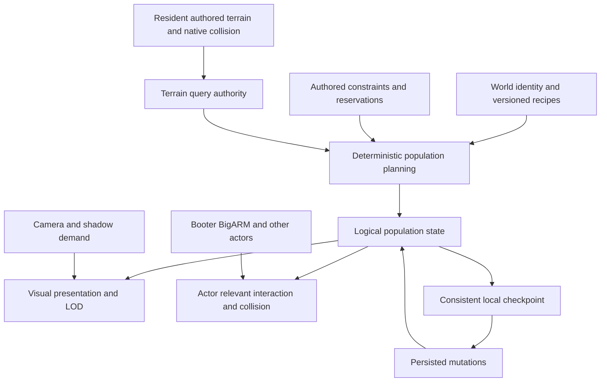

# Greater Wasteland World Architecture Baseline

Initial report: October 11, 2026. Reconciled baseline: October 12, 2026. Audience: the author and implementation owners. Coordination: Gottspan; Unity integration: Babineaux; verified local commits: Gear Ball.

Current evidence: conservative terrain render residency is the primary measured improvement. The latest [corrected camera diagnostic](GREATER_WASTELAND_PERFORMANCE_IMPLEMENTATION.md#corrected-camera-transition-measurement--october-12) averages 2.15 ms stationary and 2.27 ms over a 1 km square camera sweep, with 32–121 terrain renderers and all 8,704 colliders retained. Earlier all-terrain controls cost 169–186 ms; avoid a fixed speedup claim across observer revisions. The [authored-sector checkpoint](GREATER_WASTELAND_PERFORMANCE_IMPLEMENTATION.md#authored-reference-sector-and-demand-checkpoint-october-12) adds bounded scheduling and 390 accepted basalt placements on sixteen unchanged native tiles. Interactive FPS, dense production population, save migration and author visual/traversal acceptance remain open.

Greater Wasteland should use fixed resident terrain, deterministic procedural population, actor-aware collision, bounded visual presentation and local versioned saves. World identity and saved changes must survive changes in rendering, processing partitions and population visibility. The strongest measured performance opportunity is reducing the number of Terrain components participating in rendering. Storage architecture matters for saving, reconstruction and future population scale, but does not address that terrain bottleneck by itself.

This baseline consolidates the performance audit, chunk experiments, earlier game research and first implementation results. It guides the remaining architecture batches in the [implementation record](GREATER_WASTELAND_PERFORMANCE_IMPLEMENTATION.md). User direction and root [AGENTS.md](../../AGENTS.md) govern scope; proposed sizes, budgets and optional backends remain subject to the proof gates below.

## World requirements

The authored native terrain stays loaded. Terrain generation and terrain streaming are outside the production design. Landscape population will be procedural, including rocks, formations, ground dressing and points of interest. Reviewed assets, placement rules and authored constraints supply that population's vocabulary.

Protect accepted terrain heights, holes, seams, collision, landmarks, routes, spawn space, camps and existing saved identities. BigARM retains a real world position and physically traverses even when offscreen. Rendering visibility cannot determine whether terrain, obstacles or gameplay state exist. Existing authored population needs compatible recipes or explicit migration before conversion; it must not silently move, duplicate or reroll.

The active host is the root Unity TopDown3D project. Archived 2D, Unreal and proprietary-engine implementations provide reference concepts and historical evidence. Their generators, save services, package selections and performance results do not become production dependencies.

The [World Systems Standard](WORLD_SYSTEMS_STANDARD.md) still contains generated-prototype terrain streaming and infinite-world assumptions. For Greater Wasteland, root authority and the [fixed-terrain dressing plan](../Design/Gameplay/FIXED_TERRAIN_DRESSING_PLAN.md) supersede those assumptions. Apply its deterministic identity, data boundaries and persistence principles to population; terrain unload/reload is not applicable because native terrain remains resident.

## Current scale and evidence scope

| Item | Baseline |
| --- | --- |
| Unity | 6000.4.0f1 |
| Render pipeline | URP 17.4.0, current Forward renderer |
| Production scene | `Assets/_Project/Scenes/Production/GreaterWasteland.unity` |
| Latest accepted terrain checkpoint | 8,704 native tiles, 34 sections, 544 sectors |
| Native tile dimensions | 256 m square; inspected heightmaps are 257 × 257 samples |
| Coarse organizational sector | 1,024 m square, normally 16 native tiles |
| Primary hardware | i7-9700K, RTX 3060 Ti, approximately 64 GB system RAM |
| Earlier measured snapshot | 8,448 Terrain components and 8,448 TerrainColliders |
| Proposed initial performance target | Stable 60 FPS at 1080p on this PC, pending Player evidence |

The accepted fourth-row checkpoint is recorded in [local workspace routing](../LOCAL_WORKSPACE.md) and its [closeout receipt](../Evidence/DeathValley/NorthRow4E512208N4026680_2026-10-11/closeout.json). Expansion continues separately. Refresh the saved scene, native-data inventory and ownership before profiling or authoring another area. Measurements from the earlier footprint are a diagnostic baseline, not measurements of the expanded scene.

## Measured performance findings

The [October 11 audit](../Evidence/Performance/GREATER_WASTELAND_AUDIT_2026-10-11.md) rendered the actual camera through an offscreen URP request at 1158 × 495. Each condition used five seconds of settling and fifteen seconds of sampling after initial renderer warmup. Actors were stationary. The local-terrain comparisons retained 52 render components within a conservative horizontal radius; terrain data, GameObjects and colliders remained loaded.

| Diagnostic condition | Enabled Terrain components | Mean update | P95 update |
| --- | ---: | ---: | ---: |
| Normal rendering | 8,448 | 215.02 ms | 232.16 ms |
| Distant heightmap drawing disabled | 8,448 | 83.30 ms | 95.17 ms |
| Distant Terrain render components disabled | 52 | 9.73 ms | 12.13 ms |
| Normal rendering repeated | 8,448 | 215.18 ms | 230.95 ms |
| Half render scale | 8,448 | 216.30 ms | 223.84 ms |
| Shadows disabled | 8,448 | 197.45 ms | 292.90 ms |

Limiting render components reduced diagnostic update cost by approximately 95.5%, or 22 times. Repeated normal measurements agreed within 0.1%. `TerrainManager.CullAllTerrains` averaged 141.83 ms normally, 52.14 ms with distant drawing disabled, and 0.46 ms with distant components disabled. These are inclusive CPU markers; nested measurements cannot be added as separate costs.

This establishes a strong priority for rendering residency. It does not promise an equivalent Player FPS increase. GPU timings and triangle counters were unavailable, and the diagnostic path includes capture overhead. Lower resolution did not materially help this CPU-dominated baseline; that result does not predict GPU cost after terrain CPU work is reduced.

Separate stationary headless simulation averaged about 1.02 ms per update. It does not rank moving-character, blocked-navigation or overlay-UI costs. A synthetic 64 KiB durable file-write pattern averaged 8.19 ms, with 9.02 ms P95; it excluded capture, serialization, hashing and actual save size. Full-scene Editor opening reached roughly 15–16 GB resident process memory. Rendering control preserves a substantial native-data/collision memory floor and does not establish a fix for the reported crashes.

The expanded 8,704-tile scene now has a separate corrected standalone Player diagnostic at 1920 × 1080. It uses manual URP offscreen rendering, ten seconds of warmup, a discarded boundary frame and thirty seconds of raw samples. These values supersede earlier Player aggregates for planning; the October 11 table remains a separate historical experiment.

| Corrected October 12 condition | Terrain renderers | Mean update | Median | P95 | P99 |
| --- | ---: | ---: | ---: | ---: | ---: |
| All terrain | 8,704 | 169.54 ms | 168.61 ms | 175.87 ms | 194.38 ms |
| Runtime window | 1,247 | 22.27 ms | 21.13 ms | 28.98 ms | 41.04 ms |
| All terrain repeated | 8,704 | 172.31 ms | 170.93 ms | 179.75 ms | 202.83 ms |

All conditions retain 8,704 enabled TerrainColliders. The [raw-sample receipt](../Evidence/Performance/player-clean-render-receipt-2026-10-12.json) binds source and results. Mean diagnostic cost improves approximately 87%; terrain culling falls from 111.77–113.81 ms to 10.49 ms. GPU timings are unavailable. Automatic batch rendering produced no valid samples and was rejected. Manual rendering excludes normal presented-frame/UI behavior, and saves were disabled in the isolated candidate. Do not convert these costs into an interactive FPS claim.

The subsequent [height-coverage implementation](GREATER_WASTELAND_PERFORMANCE_IMPLEMENTATION.md#height-clipped-camera-coverage--october-12) intersects camera coverage with the fixed terrain height range while retaining conservative shadow coverage and an 8 km far clip. Its first diagnostic retains 32 terrain renderers and all 8,704 colliders: 4.48 ms mean, 4.40 ms median, 5.01 ms P95 and 6.19 ms P99. Terrain culling averages 0.216 ms. A quiet matched all-terrain control measures 186.10 ms mean and 180.09 ms median; an earlier control overlapping a read-only metadata scan measured 229.08 ms mean and is retained with that limitation. Report the run variability rather than promise a fixed speedup. The [63-case test/source receipt](../Evidence/Performance/camera-height-coverage-receipt-2026-10-12.json) binds coverage tests and Player evidence. Camera transitions, native vegetation changes, real gameplay and GPU timing still need their applicable acceptance gates.

Architectural implication: keep render residency separate from resident terrain/collision and optimize conservative demand first. Current stationary evidence does not justify merging native terrain or investing in custom terrain proxies yet. Preserve those as conditional studies if interactive or moving-camera measurements expose a remaining bottleneck.

The subsequent [corrected transition receipt](../Evidence/Performance/camera-transition-resolved-receipt-2026-10-12.json) validates explicit preparation of the transient rendering controller before manual culling. The stationary control averages 2.15 ms (P95 2.62, P99 3.11); a four-kilometre camera sweep averages 2.27 ms (P95 2.94, P99 3.98), crossing sixteen native cells and four sectors with 32–121 renderers. Near cell crossings, mean updates are essentially unchanged from those away from crossings in this route. The 19.07 ms overall maximum occurs away from a crossing. Lower means partly remove diagnostic lookup overhead; this is not another production optimization. Endpoint images do not establish full-route appearance, and the camera-only test cannot establish population/actor readiness or interactive FPS.

## Implemented changes and remaining proof

The first three local implementation commits are `39a5330b8`, `9f7a7d068` and `ee0b2f690`. [Final verification](../Evidence/Performance/performance-implementation-receipt-2026-10-11.json) binds 28 source/metadata hashes to **29 passing focused EditMode cases**, with none skipped. The small isolated project excluded native terrain and production scenes.

Commit `d6326e9c5` subsequently adds population state and save compatibility. Its [candidate-bound receipt](../Evidence/Performance/population-state-receipt-2026-10-12.json) and [test results](../Evidence/Performance/population-state-editmode-2026-10-12.xml) record **46 passing focused cases**, none skipped. The [placement/presentation receipt](../Evidence/Performance/population-placement-receipt-2026-10-12.json) records the subsequent **54-case suite**, including eight new cases. These are successive suite totals, not additive counts; neither proves Player performance or production population acceptance.

| System | Current implementation | Remaining gate |
| --- | --- | --- |
| Terrain queries | `FixedTerrainSurfaceIndex` accepts rendering-disabled terrain when valid native collision remains active; holes and mismatched/disabled collision reject queries | Production traversal and remote queries |
| Terrain rendering | Sector index, gameplay/reflection camera coverage, conservative shadow coverage, immediate arrivals, retained boundary margin, bounded departures and restoration of original flags | Player CPU/GPU/memory, startup, motion, seams and visual acceptance |
| Editor interaction | Play Mode Scene views preview the runtime terrain set; their far clips cannot re-enable the whole landscape | Author workflow acceptance; Edit Mode flags restore |
| BigARM routing | Failed/blocked routes respect retry timing; one direction query cannot rebuild twice; reached-path replanning remains immediate | Moving and obstructed companion profiling and feel |
| Automatic saves | Immutable encoded snapshots, one background filesystem worker, one latest pending checkpoint, captured-revision acknowledgements, backups and failure handling | Representative payload growth, latency and shutdown scenarios |
| Explicit saves | `Save()` retains synchronous durable completion semantics | Target Player verification |
| Population identity | Stateless world/seed/version/recipe/cell/ordinal keys and independent streams; independent Python reference vector | Production seed, content recipes, constraints and neighbour placement |
| Population state | Frozen accepted-cell addresses/digests, explicit reconstruction metadata and sparse stable-ID removals; releasing caches retains receipts and mutations | Native compatibility revision providers, depletion/placed-object schemas and generated definitions |
| Population checkpoint | Opt-in payload version 2 through the existing save owner; unbound version-1 saves remain supported; incompatible restore rejected before adoption | Production binding and explicit migration; payload growth and partitioned consistency |
| Placement and presentation | Bounded study planner, neighbour thinning, protected footprints and pooled static art with independent visual/collision relevance, capacity admission and live removal reconciliation | Dense batching, measured prefab costs and production gameplay integration |
| Reference-sector integration | Original native world poses/hashes, camera/shadow and independent actor-marker demand, live removals, restoration and bounded-area scheduling | Real gameplay actors, startup/prefetch gates, 64/128 m comparison, production constraints and Player/visual proof |

Snapshot capture and JSON encoding still run on the main thread. The 8 × 8 candidate-position helper is a bounded study lattice, not accepted production density or formation grammar. Identity ordinals can extend beyond that lattice. Logical population state and opt-in persistence exist, but no production seed/state binding, generator, population save migration or dense sector has been installed.

Runtime teardown bodies were exercised explicitly in EditMode where normal MonoBehaviour callbacks do not run automatically. Automatic Player lifecycle behavior, FPS and appearance remain separate acceptance gates. Dynamic population lights must register shadow contribution; offscreen callers that bypass URP camera callbacks must prepare camera coverage before culling.

## Research lessons to retain

The [Crimson Desert notes](../Research/CRIMSON_DESERT_GAMESCOM_DEV_2026_TECHNICAL_NOTES.md) support authored samples converted into placement rules, purpose-driven density, predictable preparation, cancellation and keeping outgoing representations until replacements are ready. They distinguish official principles from reported technical details. Their world size, sector dimensions, vegetation counts and distance bands do not determine this game's constants.

The [World Creator architecture](../Design/DeferredGeneration/WORLD_CREATOR_ARCHITECTURE_PLAN.md) separates canonical plans from temporary Unity objects and divides planning, compilation and integration. Its reusable lessons include bounded work, pooled buffers, memory-limited caches, separate identity/version domains and saved mutations feeding distant proxies. Its generated-terrain and infinite-world scope is superseded for Greater Wasteland.

The [earlier world-generation research](../Design/DeferredGeneration/WORLD_GEN_RESEARCH_SUMMARY.md) discusses authored anchors, readable sparse environments and data/presentation separation, including references to Caves of Qud and RimWorld. Its Tilemap-specific advice belongs to the former 2D host. Intentional empty space remains part of composition; increasing object counts is not a quality metric.

The [preserved engine checkpoint](../../Archive/ProprietaryEngine/Docs/WORLD_SAVE_CHECKPOINT.md) and [application integration](../../Archive/ProprietaryEngine/Docs/WORLD_SAVE_APPLICATION_RESULT.md) provide a useful local-file precedent: immutable checkpoint generations, member validation, a manifest published last, previous-generation recovery, writer ownership and stale-generation rejection. Historical tests exercised interrupted writes, corrupt-member recovery and removed rocks surviving reconstruction/restart. They establish prior native/Mac behavior, not fresh Unity/Windows or actual power-loss proof. Retain their contracts rather than their fixed limits or engine dependencies.

## Recommended authority model

The architecture has three distinct kinds of state. Static definitions and authored terrain describe the world. Deterministic population records describe its procedural baseline. Mutable runtime state records what players and simulation have changed. Renderers, colliders and visual caches realize that state according to current demand.

A released mesh, instance buffer or presenter does not erase an object or undo depletion. A gameplay query must resolve logical definitions and state without requiring every object to have a live GameObject. Native terrain collision remains resident independently of the population collision policy.

Keep one authority for each responsibility. The existing generated-world services remain inactive. Extend the active save owner and gameplay state providers through explicit compatibility steps; do not add a competing generator or second inventory/world save authority.

### Module boundaries for implementation

| Module | Owns | Contract with other modules |
| --- | --- | --- |
| Native surface index | Authored ground queries and valid native collision | Rendering flags cannot change ground truth; reject holes and unavailable collision |
| World metadata and recipe catalog | Seed, reconstruction versions, asset definitions and authored reservations | Explicit compatibility; preserve accepted cells across expansion |
| Population planner | Candidate identities, accepted placements and cross-cell constraints | Same immutable inputs produce the same records regardless of demand or work order |
| Population state | Accepted receipts and mutable removals, depletion and placements | Gameplay remains addressable without live renderers; current removal support must grow through versioned schemas |
| Demand scheduler | Camera/shadow coverage, actor relevance, priorities and bounded queues | Demand changes preparation order and residency, never generated identity |
| Presentation backends | Shared meshes/materials, LOD, pooled objects or instance buffers | Consume logical state; preserve outgoing coverage until replacements are ready |
| Existing checkpoint owner | Consistent capture, revision acknowledgements and recoverable local writes | Restore compatible world and actor state together; reject stale/incompatible adoption |

These are responsibility boundaries within the active runtime assembly, not a requirement for seven new services or assemblies. The next slice should connect the existing foundations with the smallest explicit contracts and a bounded reference sector.

## Chunk ownership and version contracts

| Division | Intended responsibility | Status |
| --- | --- | --- |
| 256 m identity cell | Permanent candidate ownership and saved addresses | Initial baseline aligned with native terrain; identity foundation implemented |
| 64 or 128 m presentation/work cell | Smaller preparation, uploads and activation batches | Compare in the bounded sector; changing it must preserve IDs |
| 1,024 m sector | Coarse lookup, composition and multi-cell feature organization | Existing organization and renderer index |

These divisions need not share lifetimes. Physical terrain grouping can change in a later validated representation study without changing logical population ownership.

Generated IDs derive from explicit world identity, seed, generation domain/version, recipe/version, owner cell and candidate ordinal. Assign ordinals before density, mask or spacing rejection. Never derive persistent IDs from accepted-list position, visitation order, camera visibility, worker completion order or Unity instance IDs.

World metadata must describe reconstruction versions, terrain compatibility and content catalogs. Material/LOD/work-partition changes must not reroll placement. Placement-affecting changes require explicit retention or migration. Preserve supported recipes or enough reconstruction information to restore older worlds.

Terrain expansion must not reseed existing cells through a whole-scene hash. Freeze reconstruction inputs for accepted cells. Define whether new neighbours can affect border-thinning acceptance: existing saved features must retain their accepted set or undergo an explicit migration. A stable ID alone does not prevent a feature disappearing because a new mask or neighbour rule rejects it.

Cross-cell spacing requires neighbour context and a canonical conflict rule. Large formations and POIs need one owner and footprints/reservations across every affected cell. Validate negative coordinates, corners, terrain holes, unsupported positions and protected routes before creating presentation or collision.

The [synthetic CPU study](../Evidence/Performance/chunk-population-reference-2026-10-11.json) accepted 974 of 1,024 candidates across a 1,024 m square with sixteen identity cells. Three evaluation orders and fresh 64/128/256 m work partitions produced identical records. A 12 m spacing requirement yielded minima of 12.06 m overall and 12.28 m across cell borders; a protected-site mask and serialized sparse depletion also passed. All six checks passed. These Python results demonstrate one bounded ownership/halo rule; they do not prove native terrain grounding, production density, Unity timing or CPU/GPU parity.

## Scheduling and presentation lifecycle

Requests carry immutable identity, recipe/constraint versions and current demand. Camera position, actor position, velocity and anticipated entry affect priority only. Cancellation and stale-result checks prevent obsolete work from being adopted; neither can change generated contents.

Separate candidate planning, terrain/constraint evaluation, geometry preparation, uploads, collider preparation and main-thread activation. Pure work can run in background workers; Unity calls require their supported execution context. A 1–2 ms proposed frame budget is useful only when individual work units are also bounded. One large mesh upload or collider cook can exceed it before a scheduler checks the clock.

Prioritize necessary collision and interaction before actors arrive, including BigARM outside the camera. Route queries need obstacle information beyond the visible set. Keep valid outgoing presentations until replacements are integrated, and use retention margins to prevent boundary churn. Pool reusable buffers/presenters and cap pending requests, completed results, cached records, instance buffers and physics proxies by memory.

The [collision activation barrier](GREATER_WASTELAND_PERFORMANCE_IMPLEMENTATION.md#population-collision-activation-barrier--october-12) now provides explicit cell/region readiness. It requires full current collision publication, rejects unknown/faulted cells and pending work, and treats exact boundary seams conservatively. The reference study proves that offscreen demand remains independent of visibility and that its edge marker cannot claim unavailable neighbour coverage. Thirty-six relevant focused cases pass. This is a prerequisite for actor entry, not a completed movement gate: callers still supply footprint/lookahead margins, physics synchronization, ground/route validation and locomotion enforcement.

Start with shared accepted meshes/materials and conventional LODs. Keep batches spatially bounded so they can be culled. Dense cosmetic clutter should not require a MonoBehaviour, collider and Update callback for every instance. Geometry is valuable for silhouettes and interaction; distant detail can use simpler representations derived from the same logical state.

## Local persistence design

Keep terrain, meshes, textures and audio in native Unity assets. Keep mutable saves outside project content under the application save location. Use memory for active gameplay state; disk access belongs in bounded preparation and checkpoint work.

Store seeds, reconstruction versions and sparse changes. An unchanged procedural rock can be regenerated. A removed rock needs a stable-ID removal record; a depleted resource needs remaining-use state; a placed object needs its identity and relevant pose/state. Persistent processes such as harvesters retain logical progress independently of presentation lifetime.

The existing save envelope and path remain version 1, with integrity checks, a 1 MiB encoded-file limit and backup recovery. Unbound inventory payloads remain version 1; explicitly bound population uses payload version 2. Bound worlds reject legacy saves lacking reconstruction metadata rather than inventing a seed. This opt-in format cannot become an unbounded container for whole-world population. Accepted-cell receipts contain candidate addresses as well as sparse removals, so payload growth must account for unchanged accepted content too. Current resource restoration validates definitions from scene nodes; generated resources require a logical definition resolver that remains available when their presentations are absent.

Capture related inventory, actor and world mutations at one consistent boundary. Completion acknowledges exactly the captured revisions. When storage is partitioned, publish one checkpoint generation referencing its complete member set, or use an equivalent database transaction. Loading must not combine new inventory with old resource depletion. Preserve previous valid checkpoints, reject stale writers, validate versions and test interrupted writes before replacing the current save format.

| Backend | Strength | Cost and decision gate |
| --- | --- | --- |
| Versioned local files | Existing project direction and historical checkpoint precedent; easy inspection | Multi-part consistency, indexing and recovery are application responsibilities |
| Embedded SQLite | Local indexed lookups and transactions across related records | Unity/platform integration, schema migration, backup and checkpoint policy need validation |
| Remote database | Relevant if later online shared-state requirements demand it | No present requirement; would add network/service dependence |

Continue with local storage and complete the state/checkpoint contracts first. Compare files with SQLite using representative changed-cell counts, record sizes, lookup patterns, checkpoint latency and recovery behavior before choosing a long-term backend. SQLite can be embedded locally without a separate server; its transaction and journal behavior still require an appropriate backup policy. [SQLite intended uses](https://www.sqlite.org/whentouse.html), [SQLite application files](https://www.sqlite.org/appfileformat.html), [SQLite write-ahead logging](https://www.sqlite.org/wal.html).

## Conditional optimization studies

| Study | Entry condition | Preservation requirement |
| --- | --- | --- |
| 512 or 1,024 m native tile grouping | Terrain overhead remains material after rendering control | Heights, holes, seams, collision, materials, GUID accounting and logical ownership |
| GPU indirect clutter | Dense shared-mesh population becomes a measured submission/rendering bottleneck | Accepted placements and gameplay state remain authoritative; local draw bounds and buffer caps |
| GPU Resident Drawer or GPU occlusion | Compatible props and a justified renderer-path study | Current Forward renderer needs compatibility work; native Terrain is not its MeshRenderer route |
| Render-only terrain proxies | Simpler native controls miss measured goals | Native terrain/collision remain resident; prove silhouettes, materials, holes and ground agreement |
| Fixed-data clipmaps | Grouping/proxies fail and the expected gain justifies a larger renderer investment | Sample authored data; do not synthesize replacement terrain |

At one-metre spacing, grouping the measured 8,448 tiles into 528 larger 1,024 m tiles would reduce component count sixteenfold but raw height-sample count by only about 0.6%. That is not a sixteenfold memory saving or measured speedup. The [experiment plan](../Research/Engineering/GREATER_WASTELAND_CHUNK_EXPERIMENTS_2026-10-11.md) records the tradeoffs.

Physics broad-phase changes, dust-map caching, UI batching, cargo refreshes and texture residency remain narrower studies driven by subsequent profiling. Whole-world occlusion baking, blanket Read/Write removal, graphics-quality cuts and an engine/DOTS rewrite are not the first response to this evidence.

## Implementation sequence and acceptance gates

1. **Refresh the performance baseline.** Freeze the accepted scene/content, record native and active counts, establish memory headroom and run one bounded full-content rendering process at a time. Compare all-terrain rendering with the runtime window using matched settings. Separate startup, steady frames, camera/sector transitions and saves. Stop for sustained resource growth or loss of responsiveness.
2. **Complete production metadata and state integration.** Build on the verified identity, accepted-cell receipts and removal state. Define production seed selection, native compatibility revisions, logical definitions, authored constraints, depletion/placement ownership and migration. Prove reconstruction after presentation release before generating dense content.
3. **Build one constrained sector.** Compare 64/128 m work cells, actor collision preparation, conventional LOD/pooling and neighbour rules on accepted art. Test boundary handoffs, offscreen BigARM and changed objects. Review at the production camera and along approach routes.
4. **Scale consistent local checkpoints.** Build on opt-in version-2 joint capture. Establish representative payload limits and partitioned checkpoint consistency before exceeding the current bounded format. Benchmark a database against the complete file contract.
5. **Expand progressively.** Raise population density and area only after frame, memory, reconstruction and author acceptance gates pass. Select optional rendering experiments from the remaining bottleneck.

Record median/P95/P99 frame time, transition/save spikes, CPU/GPU timing availability, memory peaks, active render/collision counts, allocations, uploads and queue depth. CPU and GPU work can overlap; evaluate the actual critical frame path rather than adding their durations as if serial. A 60 FPS frame has approximately 16.7 ms available; the subsystem budgets remain provisional until Player measurements establish headroom.

Determinism checks vary cell order, worker completion order, visibility, LOD and work partitions. Persistence checks cover recreate/restart, removed/depleted/placed objects, incompatible versions, stale writers, corrupt members and interrupted publication. Terrain checks cover unchanged data, valid collision with rendering off, seams, holes, borders, shadows and restoration. Hands-on gameplay and appearance acceptance remain author-owned; compilation, EditMode checks and a successful build cannot substitute for them.

## Completion criteria

The principal unresolved risks are low-angle shadow coverage expanding the render set, resident native-data memory remaining high, actor collision arriving too late, stale jobs adopting incompatible content, and checkpoints exceeding their size budget. Each needs a bounded test or measurement before area/density growth. A time-sliced scheduler also needs backpressure and replacement headroom: a full pool must defer work safely while retaining current coverage rather than grow without limit or leave an unfinishable replacement queued.

The architecture is ready to scale when matched Player captures show repeatable improvement and acceptable frame-time variation; native terrain and collision remain correct; generated identities and saved changes survive representation recreation; preparation queues and memory stay bounded; checkpoint failure/recovery tests pass; and the author accepts traversal, camera views, lighting and population composition.

Until then, the remaining implementation goal stays active. This baseline does not authorize terrain generation/streaming, silent save conversion, package changes, broad renderer migration or external publication. The next concrete work is to measure camera/sector transition costs and compare presentation partitions/startup readiness in the authored reference sector before connecting real gameplay actors and production saves. Interactive appearance/traversal acceptance remains author-owned.
