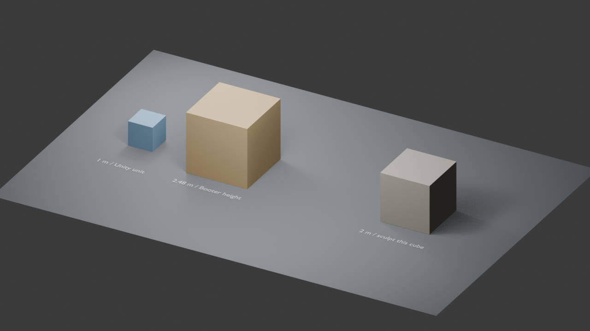

# Rock sculpt starter — October 9, 2026

Blender 5.2.2 LTS created and reopened the local `SourceArt/Blender/Studies/RockSculpting/RockSculptStarter_2026-10-09.blend`. [Authoring guide](../../../../SourceArt/Blender/Studies/RockSculpting/README.md) and launcher remain in its source folder; the native Blender file and backups are excluded from Git.

- [Creation](creation-2026-10-09.json): metric units, 1 m reference, 2.48 m player-height reference, 2 m working cube, applied scales, 18 by 12 m ground, 24,578 sculpt vertices and 24,576 quad faces. The initial background active workspace was Layout; this is an intermediate checkpoint.
- [Interactive preparation](interactive-session-2026-10-09.json): Sculpting workspace, active `Rock_Sculpt_01`, Sculpt Mode and Clay Strips, brush viewport available, initial workspace state saved to the local source once. No global preferences were saved.
- [Read-only reopen](reopen-2026-10-09.json): dimensions/pivot/unit scale preserved, symmetry off, no non-manifold edges or loose vertices, protected references. Disposable render settings did not overwrite the source.

The GUI process opened the saved project with `--no-window-focus`; its title matched this source and the process was responding. No window focus/foreground call, keystroke automation, Unity import, export, gameplay smoke test or Player profiling was performed. The image is a separate scene render, not a screenshot of the interactive Blender UI. No artistic rock shape or tablet response is accepted by these checks.

Later October 9, the author requested a tan Booter reference cube. [The material update](tan-update-2026-10-09.json) records the lighter tan viewport and shader colour. The pre-change local source was preserved, geometry was not modified, and the saved project was reopened without taking foreground focus. The image above retains the initial ochre material as historical creation evidence.
