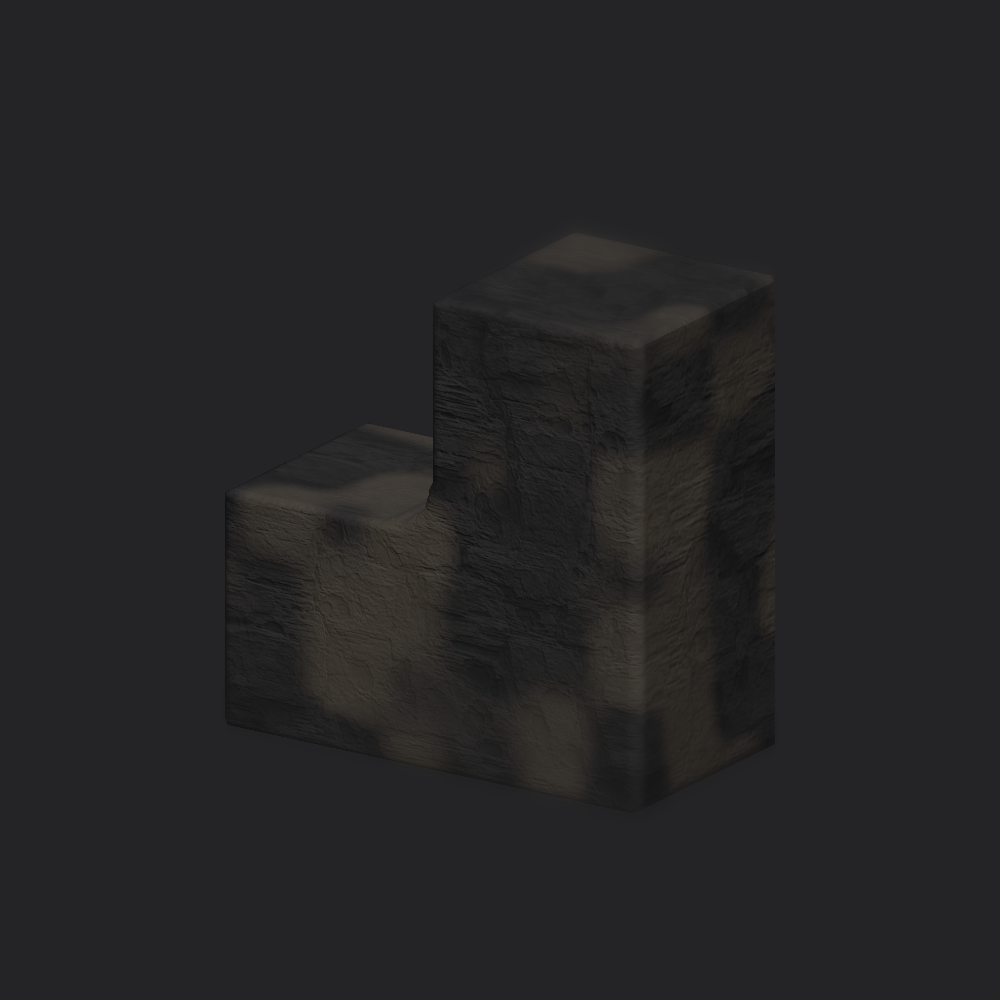

# Minimal cube rock delivery

October 10, 2026. The center study has one plain rock-textured cube whose copies automatically fuse when touching in Edit Mode. Sources remain editable with normal Transform tools. No workbench, new panel, buttons, sliders, settings fields or source-order IDs were added.

## Delivered behavior

The persistent starter prefab is [SmoothRockCube](../../../../Assets/_Project/Prefabs/TopDown3D/Environment/SmoothRockCube.prefab). Its live instance is under Area 05 at `(-3, 0.5, 0)`. The study was already dirty; insertion uses Undo and leaves the author's normal scene Save responsible for persistence. The saved study file retains SHA-256 `7F0D2831A7F38DB87B3BA3043443ABC818E5EC3D4E9489F1D16FC75F57649170`. Both basalt instances and the existing workbench retain their baseline positions, rotations and scales. The cube adds no collider or Rigidbody. Live readback found one cube, zero settings fields, the existing material, visible source rendering and zero missing scripts.

The shape is a sampled spherical closing of the exact oriented-box union: expand the union by a bounded radius, then contract by a spherical lattice neighborhood. Min/max operations make the field independent of input order and primitive multiplicity. This avoids the old smooth-minimum duplicate swelling. The field preserves the original union against lattice approximation error. It does not promise unchanged volume at every join or mathematically smooth curvature at arbitrary grid resolution. The geometry uses fixed 0.04 m samples and a 0.2 m junction radius, with 32-source and one-million-output-sample bounds. Sources remain visible on invalid or oversized input rather than silently coarsening the mesh.

The shared marching-tetrahedra implementation gained one bounded sampled-field entry point. Existing workbench extraction, cap and relaxation behavior remain intact. Field sampling and extraction run on one numeric worker; Unity mesh creation and renderer replacement stay on the main thread. Obsolete display is retired on movement, stale results are discarded, and owned meshes/culling state clear on Undo, scene Save/close, compilation and Play transitions. A selected cube has a wire outline; exterior clicks choose a source, with all hidden/contained sources available through the Hierarchy.

The existing layered rock shader/material uses fixed world coordinates and surface calibration. Scene Save stores source objects, not the transient exterior. Editor reload reconstructs it. Play Mode uses ordinary source cubes; returning to Edit Mode reconstructs fusion. No runtime generation, gameplay save change, terrain population, production build, package change or foreground activation occurred.

Technique reference: [SciPy's closing definition](https://docs.scipy.org/doc/scipy/reference/generated/scipy.ndimage.binary_closing.html) defines erosion after dilation. The C# implementation is project-owned and does not install or call SciPy. The source-bound [research report](../../../Research/Art/SMOOTH_CUBE_ROCK_FUSION_RESEARCH.md) describes why ordered smooth minimum was rejected.

## Current machine proof

The isolated dependency-scoped candidate is `D:/BooterBigArmValidation/SmoothCubeRock20261010Candidate`, based on `09775dc96` plus the exact task-owned overlay. It includes the study's native dependencies, all needed code/materials/settings and pinned packages, and excludes unrelated dirty production terrain bytes. The initial full copy was stopped because production terrain was unnecessary. That partial task-owned copy remains retained after automatic approval review rejected its cleanup with a blocked-by-policy response. No existing validation checkout was reused or altered.

| Proof | Result |
| --- | --- |
| [Final focused XML](final-tests.xml) | 27 passed, 0 failed: 21 cube geometry/editing cases and six existing workbench regressions |
| Geometry | Face/edge/corner contact at grid offsets, rotated/scaled contacts away from origin, duplicate and ordering invariance, near-coincident continuity, 3 m chain, retained U-shaped opening, sampled-field boundary sides, cancellation/oversize and invalid input |
| Editing | Duplicate while fused, separation, movement Undo, disable, stale-job rejection, multi-scene isolation, source Save/reload and empty-scene Edit/Play/domain transitions |
| Prefab | One source cube, correct unit mesh/material, no child hierarchy, settings fields, culling hide flags, Collider or Rigidbody |
| Existing workbench | Overlap, separation, face contact, rotated contact, relaxation and grouped formation regression checks passed |
| Live import | Background recompile completed without compilation failure; current Console ground truth reported zero errors |
| Live insertion | One cube in Area 05; old artist transforms unchanged; scene dirty and not saved |
| Asset preservation | Saved study, nine study TerrainData files, shared material and package manifests match captured hashes |
| Isolated capture | Matching original-cube and fused-exterior material images rendered successfully; no shader/compile errors in capture log |

Measured three-unit-cube face chain: one connected closed mesh, 69,000 triangles, total numeric build/extraction about 977 ms in the final regression run. The editing fixture measured about 754 ms on the worker and 1.3 ms for main-thread display application. These are one-run fixture measurements, not a shipping budget or guaranteed latency. In the original two-unit-cube fixtures, face contact volume was about 1.998 m³, edge contact about 2.028 m³ and corner contact about 2.006 m³, against a 2 m³ source union; grid phase alters the small discretization error.

The first editing run found a test-fixture Undo-group mistake: creation and movement were unintentionally one operation. Separate Undo groups corrected the fixture; the final movement/duplication checks passed. No failing assertion or input sample was removed to obtain green.

The nine-area saved layout was not rebuilt or changed, so its historical exact-child-count assertions were not relaxed. Terrain painting/sculpting and unsaved scene content remain author-owned. Other terrain and atlas work arrived concurrently and remains excluded from this commit; this task does not claim to validate that work.

## Material comparison and limits

[Original cubes](sources.png) and [fused exterior](fused.png) use the same fixed material frame, camera and neutral inspection lighting. The fused view shows the rounded reentrant junction and continuous rock texturing. This is an isolated material inspection, not a live Editor render or Greater Wasteland lighting/performance acceptance.

Author visual acceptance remains pending. No gameplay smoke test, Player build, production placement, arbitrary-stack/high-density performance or general triangle-intersection benchmark is claimed. The extractor uses a piecewise-linear tetrahedral field without a vertex relaxation pass; targeted topology and boundary-side fixtures are recorded, not unrestricted geometric guarantees. Details and captured task hashes are in [receipt.json](receipt.json).
