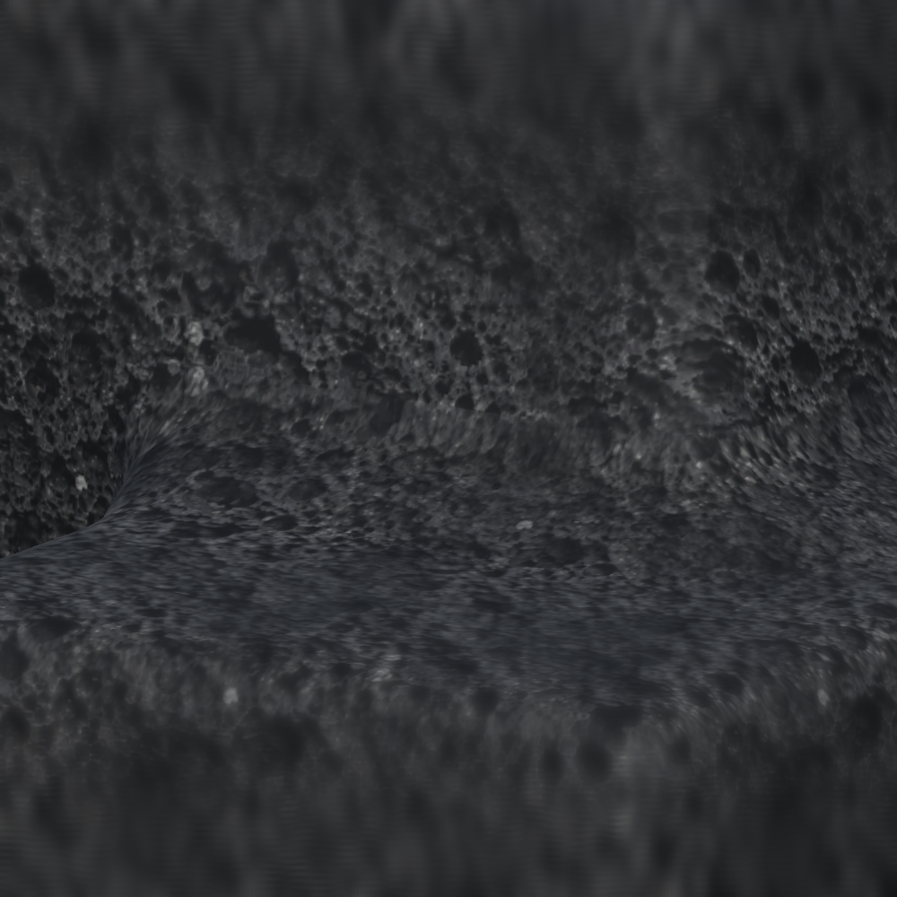

# Smooth cube join correction

October 10, 2026. The author supplied a close-up of the merge between two offset cubes, showing distinct angular terraces. The earlier wide-angle material captures and topology checks did not catch this surface-quality defect. This correction preserves the two source poses and volcanic material and changes only automatic exterior generation. There are no new user controls, workbench panels or source subdivisions.

## Cause and correction

The discrete spherical closing stencil supplied a valid connected surface but left stepped bands in the sampled field. Adding mesh triangles alone would reproduce those bands. The field now receives a separable Gaussian filter with one coarse-sample standard deviation (0.04 m), followed by cubic curve reconstruction onto a 0.02 m extraction grid. The existing tetrahedral extractor consumes that finer field. The generated exterior receives additional geometry automatically; source cubes remain normal editable cube objects.

Filtering also slightly softens exposed convex edges of a fused group. It retains flat face regions and does not smooth or rewrite the authoring transforms. The fixed 0.2 m closing radius, duplicate-neutral union, contact grouping and world-frame volcanic material remain unchanged. The shared sampled-field API retains its one-million-sample default for other callers and permits the cube path an explicitly bounded four-million-sample refined grid; legacy workbench generation caps and controls are unchanged.

The first filter trial passed the authored contour check but reduced corner-neck clearance below the established regression threshold. Reducing filter width restored those fixtures; the assertions were not loosened. The final [29 checks](smooth-joint-tests.xml) passed: 23 cube/material/editing cases and six existing workbench regressions. This includes rotated and scaled contacts, grid offsets, duplicate/order invariance, source Save/reload, Undo and stale jobs, and empty-scene Edit/Play cleanup.

## Actual arrangement and close-up proof

The regression uses the author's two unit cubes, at `(-3, 0.5, 0)` and `(-3.43, 1.041, 0.735)`, both with identity rotations. A top-surface contour through the join measures total slope variation across 76 samples: the old field gives `19.3254452`, and the corrected field gives `1.655658`, approximately 91.4% lower. This targeted metric catches the terrace defect rather than only checking closed topology; it is not a universal curvature or arbitrary-stack guarantee.

The isolated background render uses those same poses and volcanic material, with identical close-up camera and lighting. [Before](join-before.png) shows the old extracted closing surface; [after](join-after.png) shows the filtered, refined exterior. Both images were inspected. The corrected join has a continuous curved transition without the old visible ledges.

Live background compilation completed without failure, and the restored preview has 104,916 vertices and 209,828 triangles for this authored arrangement. Live readback confirmed both poses, scales, rotations and volcanic material match the pre-change snapshot. The scene remains dirty and was not saved. Neither Unity nor another app was focused or raised.

The editing fixture measured about 2,495 ms on the numeric worker and 4.5 ms for main-thread display application. The three-meter chain produced 278,160 triangles in about 2,993 ms. These are bounded fixture measurements; denser output trades rebuild cost for close-up smoothness. No production density, Player-performance, collider, package or terrain change is claimed. Author visual acceptance remains separate from this structural and rendered proof. Task-source hashes and live readback are recorded in [smooth-joint-receipt.json](smooth-joint-receipt.json).
