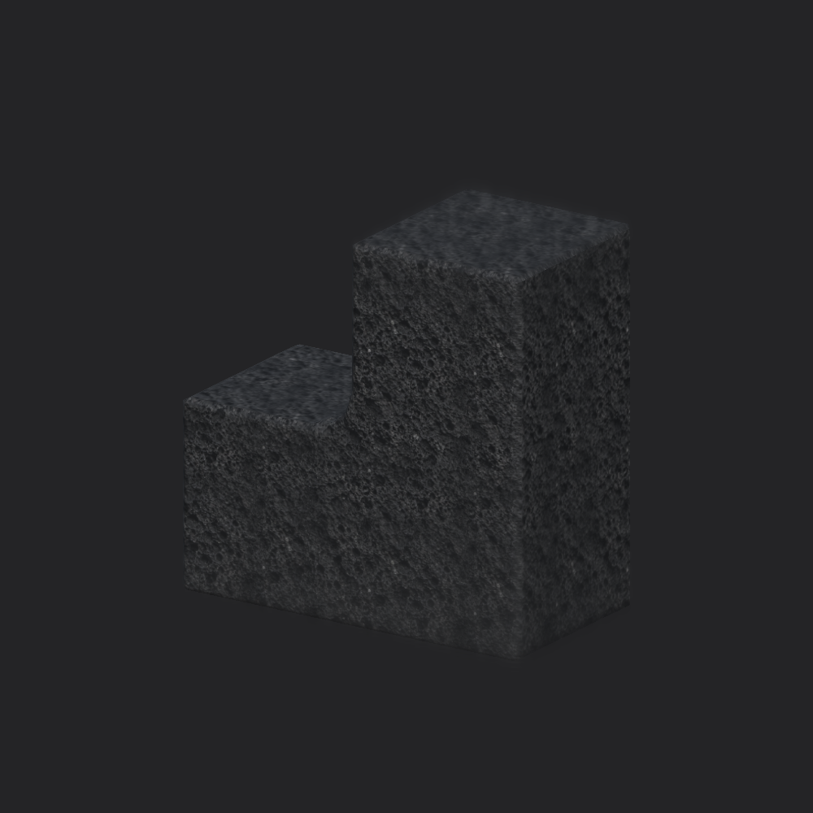

# Volcanic cube texture correction

October 10, 2026. The author requested the volcanic texture for the new cubes. Both live cube instances and the persistent starter prefab now use `Assets/_Project/Materials/TopDown3D/Rocks/SmoothCube_Volcanic.mat`. Geometry, duplication/movement behavior and the empty cube component remain unchanged; no controls or panels were added.

The runtime maps under `Assets/_Project/Art/Environment/Rocks/SmoothCubeVolcanic/` come from the existing `SourceArt/Blender/Studies/textures/VolcanicBlackBasalt_*` set, also used for the sculpted basalt assets. Albedo and OpenGL normal pixels are copied byte-identically. The packed linear surface map stores `R=AO`, `G=roughness`, and `B=16-bit source height reduced to 8-bit`. This is data-channel packing, not new generated art. Original sources and sculpted-rock materials remain untouched. The sculpted rock's UV atlas is not used on the UV-free fused mesh.

The existing shader performs orientation-aware projection for normal maps and world-meter texture projection. Volcanic maps repeat at 1.25 m; base tint is white and generic crack, grit, shale, dust and macro overlays are off. Roughness maps linearly to inverse smoothness, AO strength is 0.6, and normal strength is 0.65. Albedo imports as sRGB; normals and surface data import as linear, with Repeat wrapping, mipmaps and 4× anisotropy. All are explicit 2D textures.

The first focused check caught an importer shape mismatch and empty texture assignments. Explicit 2D import plus a non-null texture gate corrected it. The final [five focused checks](volcanic-tests.xml) passed: material/import contract, starter prefab, automatic duplication/separation/Undo/disable, source Save/reload and scene isolation, and stale-worker rejection. Geometry code is unchanged from the initial 27-case proof. The isolated render completed successfully and was visually inspected; author appearance acceptance remains separate.

Live readback verified two user-arranged cubes, both with the volcanic albedo and material, white tint and 1.25 m scale. Their positions stayed `(-3, 0.5, 0)` and `(-3.43, 1.041, 0.735)`. The scene remains dirty and was not saved over author work. The cube prefab/material/texture changes are persistent assets; normal scene Save persists instance overrides. The user's existing scene-file changes remain outside this correction's commit.

The capture uses neutral isolated inspection lighting, not the live scene. The original source texture is image-derived and may retain lighting; no measured PBR accuracy, new displacement, gameplay collision, Player build or performance claim is added. Sources, channel packing and tested code are recorded in [volcanic-receipt.json](volcanic-receipt.json).
