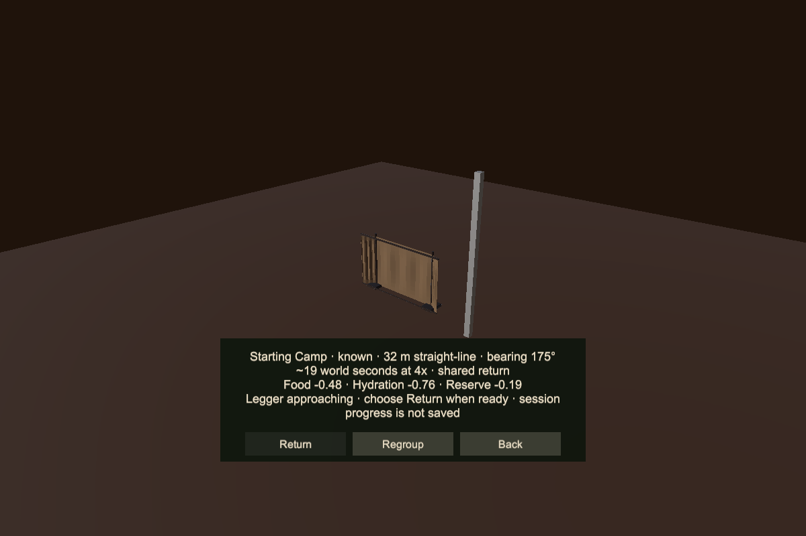
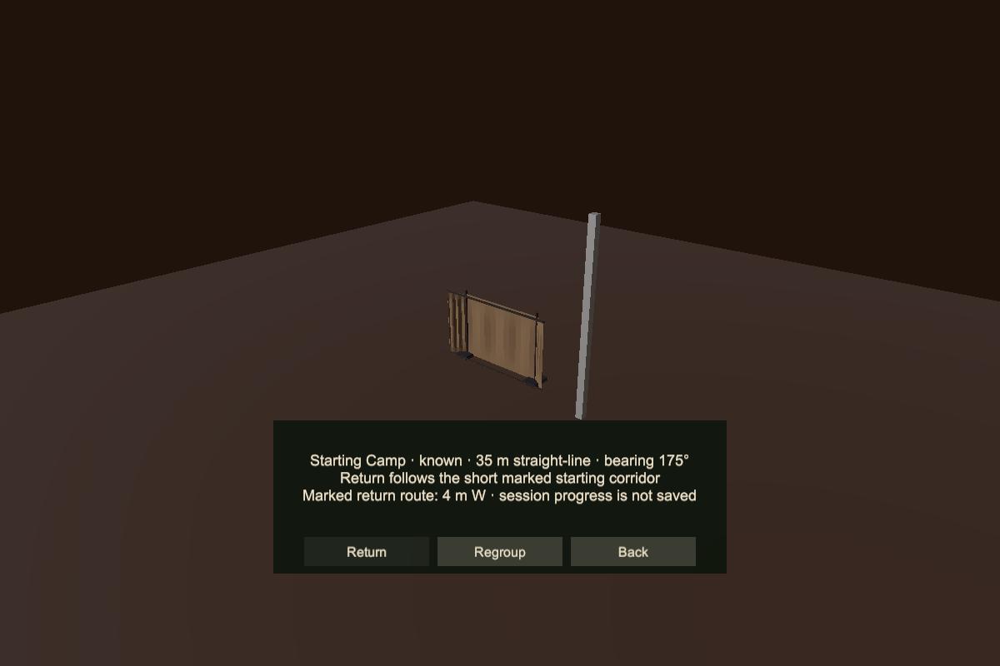

# Camp interaction audit and iteration

October 11, 2026. This iteration improves the existing Starting Camp and bounded return loop. It preserves fixed terrain, authored site identity, the corridor limits, supply costs, physical Legger movement, local cargo ownership, and session-only discovery. Crafting, storage services, persistent saves, and wider travel remain separate slices.

## Findings and changes

| Gap | Player consequence | Change |
| --- | --- | --- |
| Camp shortcut checks the portable kit rather than nearby established recovery | Selecting Camp beside Starting Camp can produce a blocked placement preview; without a kit it can be unavailable despite usable shelter | Camp now opens the nearest reachable local camp. It works at an established site without a carried kit and preserves deployed portable ownership. |
| Regroup closes the destination view | Calling the Legger requires reopening menus before travel | Regroup stays in the destination view while the world and companion continue. Arrival enables Return; it never starts travel automatically. Repeated confirmation does not restart a consumed approach command. Back remains available. |
| Outside-corridor feedback provides no way to recover | A known destination appears unusable without explaining how to reach the allowed route | The panel shows distance and compass direction to the closest point on the authored route. A wrong-height case requests the route's ground level. Guidance does not grant travel eligibility or move either actor. |
| Missing, blocked, and distant companion states share one message | Regroup appears to solve conditions that actually need repositioning or supported ground | Those cases now have distinct feedback. A blocked approach explains that Booter can close Camps and move to reconnect. |
| Progress is judged from a tiny per-update displacement | Small incremental motion can be mistaken for a stall instead of measuring progress over a window | Progress now accumulates against a retained position until meaningful horizontal distance is covered. True stalls still time out; vertical motion alone does not count. This is a robustness change, not a measured native-FPS finding. |
| Travel display lacks visible progress | The player cannot tell whether the short return is advancing | The travel display includes distance to the camp approach alongside the cancel binding. |

Return estimates remain visible while regrouping so the player can assess supply costs before the Legger arrives. The regroup confirmation must release before another action can execute. Cancel can close the panel even while the opening confirmation is still held.

## Verification

The final suite passed **123 focused EditMode checks: 123 passed, 0 failed, 0 skipped**. The acceptance result is recorded in `camp-iteration-final-tests.xml` and its corresponding log under `D:\BooterBigArmValidation\StartingCamp20261011-01`. Scene-changing tests run only in this owned isolated candidate.

The added checks cover nearby established shortcut access with and without a kit, distant-site rejection, persistent destination view during regroup, no duplicate callover, no automatic departure on arrival, closest-route guidance without expanded eligibility, small-frame accumulated progress, and distinct missing/blocked companion feedback. Existing camp, sleep, input, menu, survival, inventory UI, movement, and traversal checks are included.

The candidate was refreshed from committed source plus only the camp-owned edits. Concurrent inventory work in progress is excluded from this acceptance proof and preserved in the main checkout. This iteration changes no scene, terrain, package, input asset, or save schema. No app window was focused and no gameplay smoke test was run.

Static large-text previews of approach and route guidance were inspected without clipping. They are layout previews, not captured player journeys or evidence of native-controller feel.

## Remaining design gaps

The 32 m corridor remains a bounded study, not whole-wasteland fast travel. Its markers, narrow eligibility width, mandatory companion regroup, and supply thresholds still need the author's hands-on acceptance. The next useful player check is whether the Camp shortcut, regroup-to-return flow, and off-route guidance remove confusion without making expedition preparation tedious.

Crafting and item management are confirmed camp-hub goals, but their functional implementation remains deferred as requested. This pass introduces neither remote storage nor a teleport shortcut to compensate for missing services. Discovery still resets with the session; persistent camp state requires the separately versioned authored-world save slice.

The [initial implementation evidence](./STARTING_CAMP_IMPLEMENTATION_2026-10-11.md) remains the original checkpoint. This audit supersedes its instruction to reopen Camps after Regroup.
