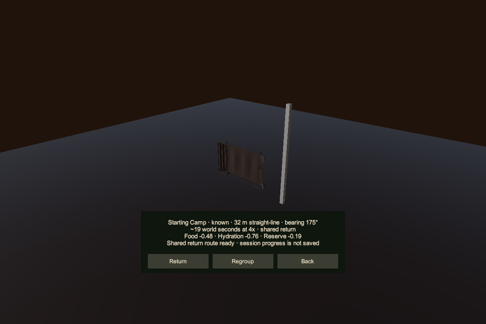
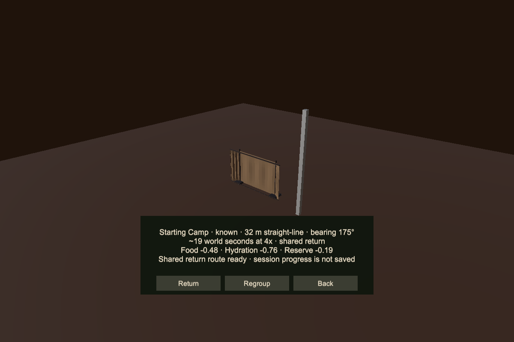
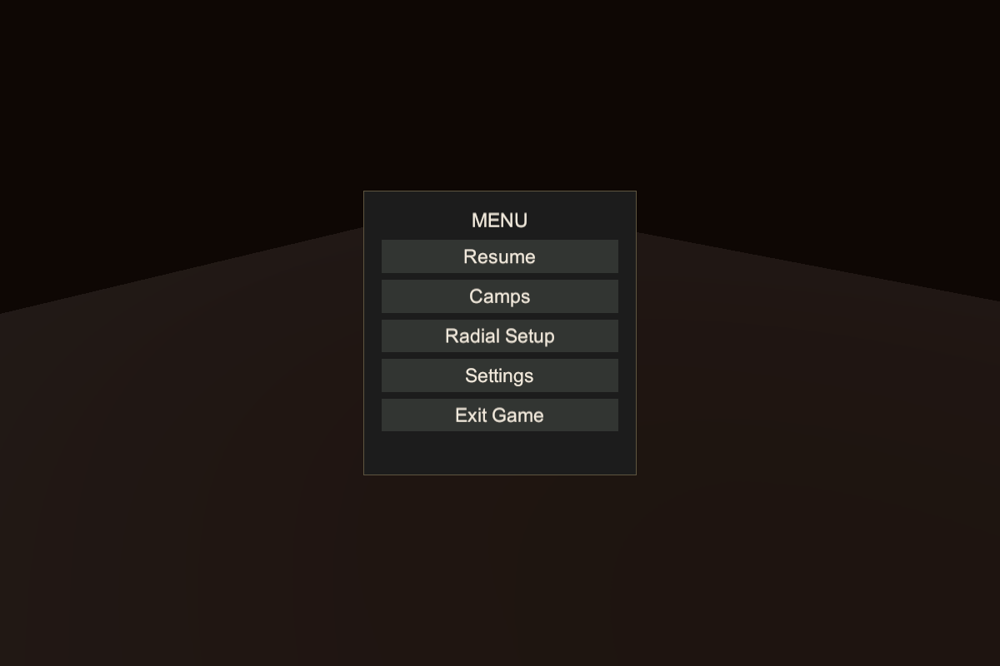

# Starting Camp and bounded return implementation

Implemented October 11, 2026 in the active Greater Wasteland lane. One established Starting Camp is installed from authored settings near Booter's existing spawn. It supports the existing Rest and Sleep actions without consuming or owning the portable shade kit. Crafting and item management remain confirmed future hub services; this slice adds neither service.

The subsequent [interaction audit and iteration](./CAMP_INTERACTION_AUDIT_2026-10-11.md) adds nearby-camp shortcut access, keeps Camps open during regroup, provides route guidance, and hardens progress detection. It supersedes the original regroup/reopen flow described below.

## Using the prototype

In Play Mode, the camp appears east of Booter's starting area at ground position `(-1842, -48.08643, -1498)`. Approach its shaded side and use the existing Interact binding to open Rest and Sleep. The established camp has no Pack up action. Portable deployment, rest, sleep, and local packing remain available independently.

Open the system menu and choose **Camps** to inspect the known destination. **Regroup** requests the Legger's existing physical callover and returns control to gameplay. Reopen Camps after he arrives. **Return** requires both actors to be ready, adequate supplies, clear ground, and Booter inside the short marked corridor. The opening Submit/Click gesture must release before another action can execute.

The corridor follows `x = -1845`, from `z = -1498` to `z = -1466`, with a 1.5 m lateral eligibility radius. Ground heights are authored in the definition and checked against live collision. A return from a valid point projects onto this corridor and follows its earlier points to the camp approach. It does not route across Greater Wasteland. The final approach is west of the camp, clear of its sleeping footprint; services still require local interaction.

Return uses physical walking at 1.8 m per simulation second and shared 4x world acceleration. The Legger follows through his existing movement authority. Cargo remains with its actual owner. Existing survival simulation applies actual elapsed depletion once; the summary is an estimate and does not spend supplies upfront. Cancel, damage, low supplies, blocked movement, lost companion progress, lost movement authority, menu handoff, focus loss, or device loss ends the journey and releases speed/input ownership. Arrival does not heal, refill, open storage, or start sleep.

## Ownership and identity

- The site definition is [TopDown3DWaypointCampSettings.asset](../../../Assets/_Project/Settings/Camping/Resources/TopDown3DWaypointCampSettings.asset). Identity is `greater-wasteland.authored.v1` / `camp.starting`; it does not depend on an object instance, label, or current spawn position.
- The logical registry owns known-site state for the session. Rebuilding the site view does not replace that registry. Scene restart returns to authored initial state; there is no disk persistence or camp-only save file.
- The portable controller retains its deployed-kit record. Its active recovery target can now be an established site independently of that record. Packing checks both ownership and the target's packability.
- A single `TopDown3DWorldSpeedController` belongs to the scene's World Simulation root. Camping and travel request exclusive use. Destroying a portable controller no longer destroys the speed authority.
- The player motor receives a bounded waypoint movement constraint. It retains physical collision, ground support, and animation presentation; it never teleports either actor. The Legger continues to own his actual movement and cargo.
- Terrain generation and terrain streaming are not applicable: Greater Wasteland stays fixed and always loaded. The site and its markers are authored presentation, without independent saved gameplay deltas. Future dressing must respect the camp and route clearance verified here; no new dressing generator or reservation framework is installed.

## Verification

The pinned Unity `6000.4.0f1` compiled the implementation. An isolated candidate at `D:\BooterBigArmValidation\StartingCamp20261011-01` ran **114 focused EditMode checks: 114 passed, 0 failed, 0 skipped**. The suite covers waypoint route rules and integration, existing camp/input/sleep behavior, menu, survival, inventory UI, locomotion, and smart traversal.

The new checks include independent camp/kit ownership, established recovery without a carried kit, forbidden established packing, deterministic route projection, world/site discovery matching, outside-corridor rejection, supply checks, obstacle rejection, menu/focus/damage/reset interruptions, missing-interface cleanup, shared speed lifetime, duplicate configuration, and held-opening-input suppression. A deterministic disposable-scene physics check verifies completed return with continuous movement of both actors, unchanged cargo, and released speed/movement ownership. It is a focused contract test, not a gameplay smoke test.

The first physics run exposed a marker/companion clearance conflict. Markers were moved farther outside the route; the completed movement check then passed. A subsequent virtual-device test exposed fixture teardown ordering: temporary Input System settings were unloaded before device removal. Restoring the existing fixture cleanup order fixed that test-harness issue without suppressing assertions or weakening checks.

A separate read-only check in the already loaded production scene passed **72 shared-route ground/width/clearance samples**, camp footprint support, arrival clearance, stable identity, the single Camps entry, and absence of generated-world/save services. It does not change scenes, install objects, save, or enter Play Mode. Production scene, native terrain, package pins, and project settings were not edited by this task. The live scene remained clean.

At the accepted source freeze, runtime/editor/test C# files matched between the working tree and test candidate. Existing gameplay work was independently committed by its owners during this task; their commits were preserved. Subsequent inventory edits and a northern terrain-section addition remain outside this feature's proof and commit. A final live recheck correctly refused to run because the Editor had moved to an untitled scene; this task did not reopen or replace it. The earlier 72-sample check applies to its inspected production checkpoint. Remaining unrelated work is preserved.

## Visual review and limits

Static previews were captured in the isolated candidate, without actor simulation or Play Mode. Normal and large-text destination panels and the enlarged system-menu layout were inspected for clipping and readability. Camera-space captures temporarily disable the isolated renderer's world distortion features and restore their prior activation states; production UI remains a screen overlay and production rendering settings are unchanged.







These are layout/art-stage previews, not production-terrain screenshots or evidence of controller feel, native-terrain traversal performance, long-distance routing, persistence, or a Player build. Hands-on gameplay acceptance remains with the author. No gameplay smoke test, build, push, package change, or external publication was performed.

## Repeatable checks

Use the read-only loaded-scene entry point through the connected production Editor:

```powershell
unity command eval 'return BooterBigArm.Editor.TopDown3DWaypointCampValidator.ValidateLoadedProduction();' --project-path 'D:\Arc & Dust\Project' --json
```

Run scene-changing EditMode fixtures only in an isolated candidate. The accepted result is `waypoint-accepted-final-tests.xml`; its log is `waypoint-accepted-final-tests.log` in the candidate root. The candidate excludes the large native terrain archive to conserve drive space, so those fixtures do not replace the live native-terrain check.

`TopDown3DWaypointCampAuthoring.AuthorFromCli` mutates only the definition and system-menu prefab and is an authoring command, not validation. `TopDown3DWaypointCampPreview.CaptureFromCli` is guarded to isolated candidates and creates static PNGs under `Logs/WaypointPreview/`.

The next scope gate is author acceptance of this short return loop. Long-distance travel, persistent discovery, local camp storage, crafting, relocation, destruction, respawn binding, and a second camp remain separate slices.
