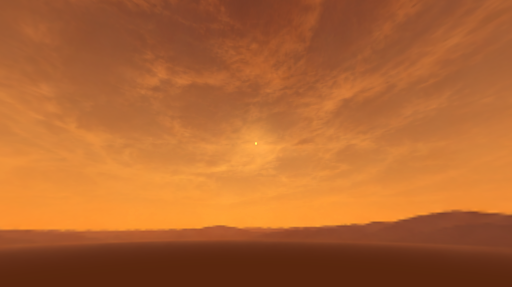

# Camp atmosphere implementation — October 14, 2026

The author-selected **Clearer twilight** study is installed only in `Assets/_Project/Scenes/Reference/CampLoopTesting.unity`. The [audited implementation plan](../../../Design/Gameplay/CAMP_LOOP_ATMOSPHERE_IMPLEMENTATION_PLAN_2026-10-14.md) and [initial audit](../../../Design/Gameplay/CAMP_LOOP_LIGHTING_CAMERA_AUDIT_2026-10-14.md) explain scope. Greater Wasteland, package pins, shared renderer/material assets and native terrain data remain unchanged.

The camera selects `Settings/Studies/CampAtmosphere20261014/Clear.asset`. Moderate and Deep are retained sibling alternatives. Generated 1774 × 887 sunless artwork supplies red ochre clouds and orange dust. A spherical shader blends its seam and poles, smooths the lower hemisphere, keeps artwork longitude fixed and adds an independent yellow solar disc/aureole driven by the existing PerpetualTwilightSun. The original sun timing, direction, light intensity and shade authority remain intact. Artwork is representative art, not surveyed geography or calibrated HDRI; [provenance](generated-artwork.json) records its source and hashes.

Ambient fill and a 128 px/face sunless linear RGBAHalf reflection cubemap follow the same study. Reflection data is derived from display artwork with ordinary mipmaps, not measured radiance or a physically convolved environment. Lighting and reflection state restore when the owner releases the study. Camera-local sky clones restore prior material/enabled state; inactive scenes cannot overwrite the active environment. Duplicate or invalid bindings reject selection. Additive scene restoration and profile changes have focused fixtures.

The new terrain-context prefab contains **95 render-only mesh sectors**, sampled from **1365 existing native terrain tiles** at nine samples per side. It excludes the nine playable camp tiles. It has no Terrain, collider, runtime component or shadow caster. It provides actual surrounding height geometry with parallax while preserving the camp's gameplay boundary. It neither expands playable terrain nor introduces generation, streaming, world identities or persisted deltas. Camp lies only 550 m north of the southern production boundary; the missing southern continuation remains artistic. Coarse silhouettes and boundary transitions still need visual acceptance.

The study disables custom tilt-shift, anamorphic streaks and round lens ghosts. Bloom uses half resolution, four levels, intensity 0.10, warm tint and aureole intensity 0.12. An initial capture exposed oversized flare ghosts and a bleached solar halo; these settings removed them. Shared renderer defaults and the existing volume are preserved. Flare history also recognizes camera position/rotation cuts for future profiles that enable it.

The separately committed [camera proof](camera-clearance-proof.json) covers follow/snaps, starting inside blockers, saturated casts, closer-than-minimum obstacles and fully enclosed cases. Orbit, FOV, pitch, look-ahead and damping are unchanged. Recovery searches a bounded set of points on the authored boom; a narrow unprobed pocket can remain unresolved. Fully enclosed cases report failure and retain a rechecked prior safe pose when possible. Riding work received the rig after commit `57b826164`; subsequent riding edits are outside this proof.

## Verification

- Pinned Windows Unity **6000.4.0f1**, URP **17.4.0**, isolated candidate `D:/BooterBigArmValidation/CampAtmosphere20261014-01`; background launches only.
- **43/43** focused EditMode atmosphere/sun/optics/camera checks: [XML](atmosphere-final2-tests.xml). Two existing view-distance render fixtures also pass: [XML](distance-final-tests.xml). The camera batch additionally ran the two existing orbit/look-ahead foundation checks. After trimming task-owned Unity serializer whitespace, all 12 study checks pass again: [XML](normalized-study-tests.xml), and installed-scene import/validation passes again.
- Installed-scene validator passes: one Clear camera binding, matching sky/reflection, 95 context sectors, nine native terrains and no study shader compiler errors. Committed NPC dependencies were restored into the candidate for the exact integrated scene check.
- Guarded additive scene integration preserved **1283 unrelated serialized records byte-for-byte**; only camera component references and the root list changed, with three new records. It preserves the NPC commit `7b0be0dca` and its high-ID records. [Implementation receipt](implementation-proof.json) binds candidate source and protected-source hashes.
- **24 static captures** cover the three skies, gameplay pitches 26/50/65, ±12 m and 150 m south offsets, bright/deep phases, four range presets and seam/zenith/nadir. The captured saved scene bytes remain unchanged. [Capture report](study-capture-report.json) records hardware and measurements; [context report](context-report.json) records the native reference views.

At 1536 × 864 on an RTX 3060 Ti/D3D11, the matched static Editor comparison averages **2.756 ms** for shared baseline optics and **2.179 ms** for Clear study optics across 60 measured renders each, after 20 warm-up renders. These are CPU `Camera.Render` submission durations, excluding readback, gameplay and presentation. GPU recorder samples were unavailable despite reported device support. This establishes no Player FPS, GPU budget or target-resolution performance acceptance.

## Visual handoff

The diagnostic camera deliberately faces the sun; the normal downward gameplay framing often cannot see the sky or solar disc. [Gameplay framing](Clear-camp-pitch26.png), [southern offset](Clear-context-offset0_-150.png), [seam](Clear-sky-seam.png), [zenith](Clear-sky-zenith.png) and [nadir](Clear-sky-nadir.png) show the relevant boundaries. Static EditMode captures display the existing capsule/companion placeholders rather than runtime-installed animation models.

Hands-on acceptance remains with the author: material/readability under moving shadows, southern boundary transition, camera clearance feel, orbit/follow transitions and actual Player GPU/frame-time profiling. No Play Mode or gameplay smoke test was run. No production promotion, terrain/source changes, package changes or push occurred. Candidate logs retain failed intermediate attempts; the linked final results are the passing evidence.
