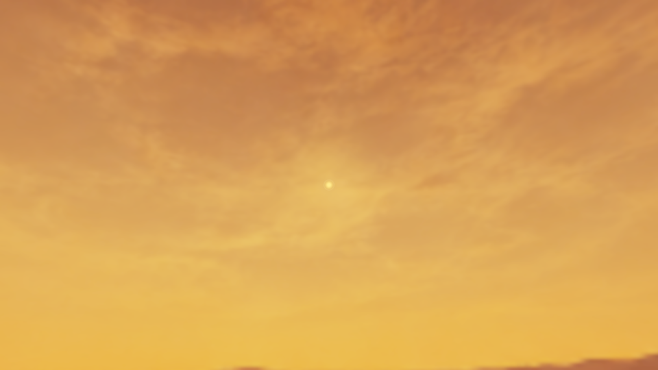

# Camp look authoring in Edit Mode

October 14, 2026. CampLoopTesting now has a **Camp Look** root containing the existing **Main Camera** and **Directional Key Light**, plus a scene-owned look controller. Existing object/component IDs, references and world poses are preserved. The terrain context remains at scene root. The scene's environment now references the approved Clearer twilight sky material and sunless reflection directly, with the authored warm light/fill colors, so the panorama is present without runtime initialization.

## Editing the look

Select **Camp Look** to access the frozen sun phase/path, direct intensity, atmosphere colors/exposure, optics and source sky material. The camera and sun component Inspectors expose the same selected assets. Bound camp cameras no longer present misleading shared-renderer settings.

- **View Sun** points Scene view toward the actual analytic sun. It changes the editing view only when clicked.
- **Match Gameplay Camera** aligns the editing view with the existing camera, including FOV and clip settings.
- **Open Edit Mode Camera Preview** renders the actual game camera at 960×540 without gameplay simulation. Use this for exact framing and native Gaussian/Bokeh comparisons, which Unity disables in its ordinary Scene view postprocessing block. The selected combined early Gaussian also previews directly in Scene view.
- **Source Sky Material Asset** exposes the panorama, sky tint and sun-disc color. Profile deep/bright sun colors control world illumination and flare; the sky material controls the disc. Computed exposure, phase, direction and profile-owned sun radius are omitted from the material controls to avoid ineffective edits.
- Camera-rig Inspector edits apply framing in Edit Mode with Undo. **Ping Sky Image** locates the existing panorama asset.

Scene lighting, sky and image effects are enabled while the look preview owns Scene view, then restored when leaving it. **Preview Scene View Effects** allows sky/light color work without lens processing. **Preview In Editor** releases the editing preview entirely. The runtime sun clock and player controls remain unchanged.

## Preview ownership

An editor-only coordinator evaluates the saved sun phase without advancing time. The sun owns a temporary sky material; material-asset edits copy into that preview. Actual Scene view cameras receive a scoped profile alias, borrowed HDR/postprocessing state and a temporary camera sky override. The private volume stack and borrowed camera settings restore after rendering. Other scene/utility cameras do not acquire this alias.

Preview state releases before scene saving, assembly reload, play transitions and scene changes. Prefab-stage editing is excluded. Temporary materials and components are not serialized, and save callbacks restore original scene references before writing. The controller is scene-owned because its references point to this authored camera/sun/player setup; sky and optics remain reusable project assets.

This adds no world generation, streaming, generated-object identity or persisted gameplay deltas. Root and asset identities follow ordinary authored Unity serialization. Preview history is editor/camera-session state.

## Verification

Pinned Unity 6000.4.0f1 / URP 17.4, D3D11, RTX 3060 Ti. Background isolated candidate: `D:/BooterBigArmValidation/CampOptics20261014-01`.

- [72 focused checks](editor-tests.xml) pass with zero failures/skips, covering preview phase/material isolation, scope release and intersecting sky/sun/optics contracts. [Four preview checks](final-preview-tests.xml) pass again after the final HDR/state-restoration changes; these are repeated checks, not four additional distinct tests.
- [Actual Scene view camera proof](scene-view-proof.json) shows a nonblack sky and an optics-on/off mean RGB difference of approximately 0.0991. Phase remains frozen, the source material remains unchanged and authoring-camera registration is restored. Linear HDR readbacks are converted to sRGB for displayed PNGs.
- [Scene integration](scene-integration.json) changes five existing rendering/hierarchy records and adds three controller/group records. All **1,347 unrelated existing records** remain byte-identical; 192 unrelated serializer differences were excluded. No terrain, gameplay, shared renderer assets, packages or build routing were changed.
- Save checks establish that temporary sky components/materials are released before serialization. No Play Mode, gameplay smoke test or foreground activation was performed.

[Sky and sun without lens processing](Scene-sky-and-sun.png).

The live author-owned Editor accepted earlier read-only state checks, but subsequent refresh commands timed out in its main-thread bridge. The saved scene and exact source are verified in the isolated Editor; completion of the live session's hot reload is unconfirmed. No author-owned Editor was restarted or focused. Preview GPU cost, actual interactive Inspector/window behavior and runtime HUD appearance are not established by the capture.
