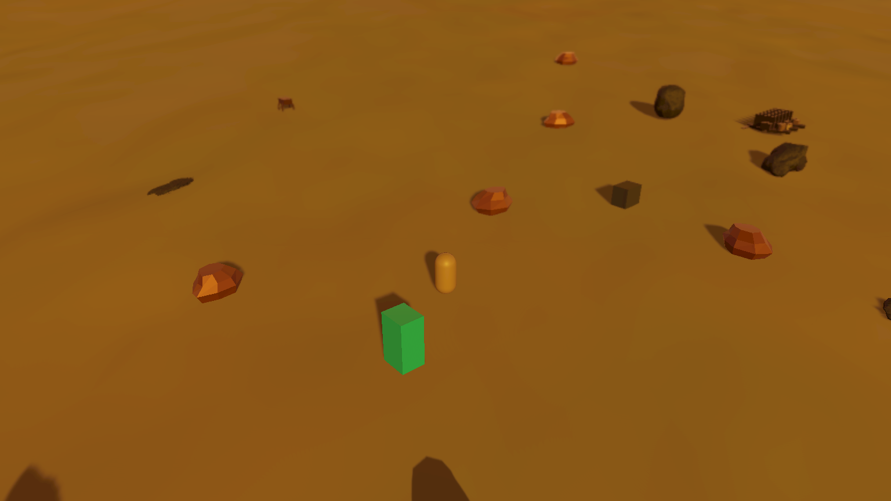
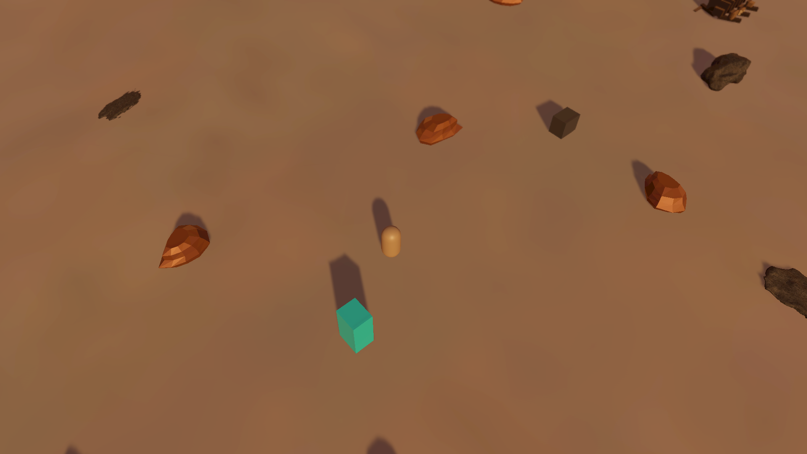

# Camp optics overhaul implementation

October 14, 2026. Implements the [audited overhaul plan](../../../Design/Gameplay/CAMP_LOOP_EFFECTS_PROCESSING_OVERHAUL_PLAN_2026-10-14.md) as camp-only sibling candidates. Clearer twilight remains the active saved-scene baseline; Greater Wasteland and the shared rendering assets/package pins are unchanged.

## Delivered processing

- Private per-camera URP volume stacks, selected during renderer setup after Unity's volume update. This works in Editor captures and Player rendering without a new volume layer, package fork or camera-stack replacement. The manager's borrowed stack restores after rendering; disable and invalid selection release owned state. Disposed borrowed stacks fall back to the valid main stack.
- One native high-quality bloom path with neutral scene tint, bloom-lit lens dirt, fixed +1 EV post exposure and Neutral/ACES comparisons. Post exposure acts after bloom extraction; it is not scene pre-exposure. Native selection suppresses the old custom bloom and its unoccluded synthetic halo.
- Opt-in artistic band blur with consistent horizontal/vertical tap units, reference-resolution scaling, band rotation and bounded center/width/feather controls. Native DOF and master-off selections suppress the band. Original camera defaults remain compatible.
- Gaussian far blur and restrained Bokeh alternatives. Player focus uses forward eye depth, a body offset and time-based smoothing; camera cuts and large target warps reset focus. An explicit binding target supports replacement/interaction anchors; missing automatic targets use manual focus until a new binding/profile selection or explicit target assignment.
- Conservative spherical solar flare: angle-scaled core/aureole, one subdued yellow ring, opaque-background visibility, immediate full-block suppression and timed partial transitions. Offscreen/missing depth is blocked. Profile/viewport/cut/source changes reset history. The native profile's angular diameter also controls its owned sky material's disc size; original sky materials are not edited.
- Two generated artist masks, with inspected 1254-square masters and deterministic 1024-square linear RGB runtime derivatives. [Provenance](generated-resources.json) records hashes, dimensions and conversion/import settings. Zero RGB means no added scattering; alpha is opaque and does not control native dirt.

The preferred Standard candidate uses native bloom/dirt plus far-only Gaussian. High substitutes restrained Bokeh and a softer mask. Low omits world blur and reduces dirt/filtering. Band is the corrected artistic alternative; Off disables the new world/lens optics while holding the selected display transform for matched comparisons. Aces changes only Standard's display transform. FXAA is a temporary camera comparison, not an adopted saved setting.

Flare is a separate native-DOF-off comparison. The existing camera-scoped custom flare runs before native postprocessing, so native bloom can see its composite. This narrower ordering was selected because native data-driven flare's shared registry did not provide demonstrated camera isolation. Standard/High do not add this custom artifact ahead of their native DOF. A later combination requires a proven HDR composition hook.

## Verification

Pinned Unity 6000.4.0f1 / URP 17.4.0, NVIDIA RTX 3060 Ti, D3D11, isolated candidate `D:/BooterBigArmValidation/CampOptics20261014-01`. All launches were background-only. No Play Mode or gameplay smoke test was run.

- **73/73** focused checks pass, **zero skipped**: [XML](optics-tests.xml). Covers owned/borrowed stacks, invalid and duplicate selection, utility/additive cameras, profile/master switches, explicit eye-depth focus/warp, blur units/masks, solar visibility/history and original sun/optics contracts.
- [Actual camera blur proof](blur-render-proof.json): off versus downsample 2/4 at 512 square, reference height 1080. RMS spread is approximately 5.80/5.75 pixels across axes at downsample 2 and 5.57/5.83 at downsample 4. Symmetry, active blur, downsample consistency and restoration gates pass.
- [Actual camera lens proof](lens-render-proof.json): native bloom-lit dirt changes the image, dirt with bloom disabled changes no pixels, clear sun produces flare, and the first fully blocked frame matches flare-off exactly. Stack, target, sun and active-scene restoration pass. These are opaque-depth fixtures; they do not establish smoke opacity or physical lens behavior.
- [Matched capture report](capture-report.json): **45 views** across nine comparisons, gameplay pitches 26/50/65 and bright/deep phases 0.25/0.75. The scene file remains byte-identical. Linear HDR readback is explicitly converted to sRGB for PNG display. Static scene captures use existing capsule/companion placeholders, not runtime animation skins.
- The standalone harness builds with an explicit rendering-fixture scene list. Gameplay scripts are removed, rendering camera/light/volume data retained, physics and animation disabled, and native processing participation guarded. Production Build Settings are not changed. Runtime shader variants remain supported by the existing postprocessing-stripping setting.

## Comparison images

Selected Standard candidate at shallow gameplay pitch:

[Original Clear baseline](Clear-pitch26.png), [artistic band](Band-pitch50.png), [ACES comparison](Aces-pitch26.png), [bright phase](Standard-phase0.25.png), [deep phase](Standard-phase0.75.png), [FXAA comparison](Fxaa-pitch26.png).

## Performance boundary

The first automatic batchmode Player run rendered no cameras and was rejected by the participation guard; its black screenshot/timing run is not accepted evidence. The harness now explicitly renders into a 1920×1080 HDR target in background batchmode, captures screenshots only during warm-up, and separates CPU submission durations from GPU timing. Player results and qualification are recorded in the closeout below.

Proposed incremental GPU targets remain 1/2/3.5 ms at p95 for Low/Standard/High. CPU submission timing cannot qualify them. Offscreen capture does not prove the actual overlay HUD raster; source routing keeps the game HUD in Screen Space Overlay, and author hands-on acceptance remains separate.

The [standalone results](player-frame-times.json) contain 18 cases: six profiles in quiet camp, with 24 bright emitters, and facing the sun. Each has 120 warm-up frames followed by 600 measured renders, totaling **10,800 measured renders**. All cases report 600 native-bridge participation samples and **zero managed bytes allocated inside that bridge** after warm-up. This is not a zero-allocation claim for the complete renderer or gameplay.

| Profile | Quiet CPU submission p95 | Emitters CPU submission p95 | Sun-view CPU submission p95 |
| --- | --- | --- | --- |
| Off | 1.96 ms | 1.79 ms | 0.77 ms |
| Low | 2.43 ms | 1.89 ms | 0.91 ms |
| Standard | 2.13 ms | 1.99 ms | 0.97 ms |
| High | 2.13 ms | 2.08 ms | 1.00 ms |

Every case reports zero valid GPU frame-timing samples. The background offscreen configuration does not provide the presentation timing needed for GPU budget qualification. The CPU values include submission to the renderer, not completed GPU execution; run-to-run differences cannot rank quality tiers reliably. Driver-allocated graphics bytes are aggregate diagnostics, not isolated render-target memory. The Player shutdown log also contains a generic ComputeBuffer cleanup warning; these results do not establish complete engine-resource leak freedom.

This closes the bounded camp implementation with a measured rendering/ownership handoff, **not performance-qualified or author-accepted production readiness**. A foreground/user-owned Player GPU profile and actual HUD/gameplay appearance check remain the qualification steps. The source and resource batches are `b90e7562c` and `9099124ce`.

## Ownership and integration

New presets are under `Assets/_Project/Settings/Studies/CampOptics20261014`. Select a sibling Twilight profile on the camp camera's existing Scene Rendering Override to compare it; Clear.asset remains available. Generated resources are under `Assets/_Project/VFX/Textures/CampOptics`, with masters under `SourceArt/Rendering/CampOptics`.

The overhaul introduces no world identity, generated objects, terrain streaming or persisted runtime deltas. Native terrain/context, sun clock/shade authority, FOV/orbit/follow/clearance and unrelated animation/riding/inventory/workstation work remain outside this change. Production promotion and author appearance/feel acceptance are pending.
