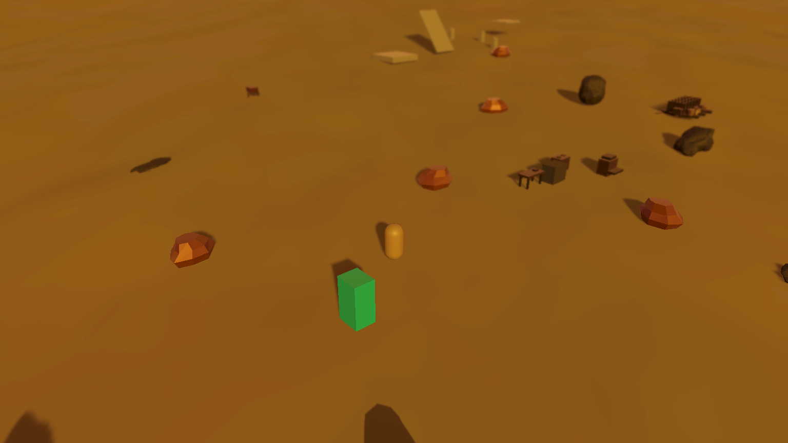

# Camp combined optics and lifecycle corrections

October 14, 2026. Implements the [audit correction sequence](../../../Design/Gameplay/CAMP_LOOP_EFFECTS_PROCESSING_IMPLEMENTATION_AUDIT_2026-10-14.md). CampLoopTesting now selects `CombinedTwilight` and explicitly focuses on Booter's existing camera-follow transform. Clearer twilight's sky, reflection and warm lighting remain the atmosphere basis; the original Clear profile is retained as a fallback.

## Combined processing

The selected order is **Gaussian world DOF → conservative solar flare → native bloom and bloom-lit lens dust → Neutral tone mapping**. The early world pass schedules the pinned URP Gaussian shader's existing CoC, prefilter, horizontal/vertical blur and composite passes through public RenderGraph/Blitter APIs at event 549. Flare follows at event 550. Native DOF is disabled for this opted-in profile, preventing a second world blur and preventing DOF from blurring lens artifacts. Native bloom remains the sole bloom producer. Flare light can feed bloom and dirt.

The selected profile uses bloom intensity 0.18, threshold 1, scatter 0.65, fine lens dust at 0.3, Gaussian radius 0.6, player eye-depth focus with a 1.15 m body offset, 5 m readable padding and 45 m far transition. Gaussian HQ sampling and bloom filter/downscale/iteration count are now explicit profile controls. Fixed post exposure stays +1 EV. The generated masks and approved sky resources are reused; no package or shared renderer-setting change was made.

Standard/High remain native Gaussian/Bokeh comparisons; Band remains the artistic alternative. Early Bokeh is rejected rather than composed incorrectly. If the early Gaussian shader is unavailable, rendering reports a warning, restores native Gaussian and suppresses the incompatible flare. The camera validator checks the selected base camera, postprocessing flag, active bridge/flare features and stock shader prerequisite.

Ordinary transparent surfaces follow the opaque depth behind them for world blur. The flare visibility signal uses opaque depth; it does not establish smoke opacity. Offscreen and behind-camera solar sources are suppressed. At downward gameplay angles, flare and solar dirt may be absent because the sun is outside the image; local HDR highlights still illuminate bloom-lit dust. The HUD remains routed through Screen Space Overlay and outside these world/lens passes.

## Focus and camera lifecycle

Automatic focus retries a missing player at a bounded half-second interval using reused scene-search lists, and reacquires a destroyed/inactive target. Explicit anchors remain preferred. Behind-near-plane and non-finite eye-depth targets preserve the profile's manual fallback. Focus smoothing uses elapsed real time per camera, with resets for large camera/target changes and render-size changes.

Previously eligible cameras now release their private stack when postprocessing is disabled, camera data disappears or the camera becomes Overlay. Binding disable, profile replacement and enabled-to-disabled camera transitions release ownership. Disabled cameras can still render manually; their end callback releases temporary ownership. The standalone harness keeps its output camera enabled during explicit batch submission so it exercises the normal persistent-camera ownership path.

The native validator rejects unsupported tone/filter/downscale enums and early Bokeh. Optional streak now honors native validity and master-off. Solar flare color uses the normalized twilight phase independently of its energy.

## Verification

Unity 6000.4.0f1 / URP 17.4.0, RTX 3060 Ti, D3D11. Validation ran in `D:/BooterBigArmValidation/CampOptics20261014-01`, updated with the current committed camp/dependencies and exact task-owned source changes. No gameplay smoke test, Play Mode entry or foreground activation was performed.

- [69 focused EditMode checks](optics-tests.xml) passed, zero failures/skips. Covers focus reacquisition/fallback, invalid enums, ownership transitions, prerequisite failures, native-stack isolation, early/native DOF exclusivity and intersecting sun/blur/flare contracts.
- [Combined camera readbacks](combined-lens-proof.json) prove world DOF, flare and dust each contribute with bloom/dirt at the selected strengths. DOF uses controlled 2–4 m fixture distances so the 5 m HDR emitters are deliberately defocused; this is a processing fixture, not camp-focus tuning.
- On a black scene, world DOF on/off yields **zero pixel difference in the lens artifact**. Fully blocked and behind-camera source comparisons also yield zero flare difference. A half-disc blocker produces a nonzero response below the unblocked response. Original bloom-disabled dirt still contributes zero.
- [50 matched current-camp captures](capture-report.json) cover ten comparisons, pitches 26/50/65 and bright/deep phases. Captures retain the current workstations and camp-management objects. Static Editor views still use authoring placeholders, rather than proving runtime character/riding appearance.
- A Development rendering-only Player build succeeded with an explicit harness scene list and retained the stock Gaussian shader. [Six standalone cases](player-frame-times.json) compare Off/Combined in quiet camp, with 24 HDR emitters and facing the sun. Each uses 120 warm-up frames and 600 measured renders: **3,600 measured renders**, 600 bridge participation samples per case and zero measured steady-state managed bytes inside that bridge. This is not a whole-renderer zero-allocation claim.

[Pitch 50](Combined-pitch50.png), [pitch 65](Combined-pitch65.png), [standalone solar view](Combined-player-sun.png).

## Performance boundary

All six cases have zero valid GPU timing samples. GPU targets remain unqualified. CPU submission p95 is approximately 17.82/28.68 ms Off/Combined in quiet camp, 33.80/28.26 ms with emitters and 4.23/4.60 ms facing the sun. These contended background submission measurements neither measure completed GPU work nor reliably rank incremental cost; the faster Combined emitter case demonstrates that limitation. They do not establish 60 FPS.

Driver memory is an aggregate diagnostic, not peak transient/history memory. The Player shutdown retains the generic ComputeBuffer cleanup warning seen in the earlier harness. Actual overlay raster, continuous-motion/depth-edge/transparent appearance, broad resolution/aspect comparisons and author-owned camera/riding feel remain acceptance work. This is an implemented camp pipeline with explicit qualification limits.

## Scene and ownership proof

[Scene integration](scene-integration.json) changes only rendering-binding record `2126727615`: the profile reference, explicit target and body offset. All **1,351 other records** remain byte-identical to the current 1,352-record scene. Camera pose/follow/clearance, terrain, inventory, riding, Ironstone processing, Camp Management and production Build Settings are preserved. Two inserted line endings were normalized to the scene's original LF convention after capture; serialized values are identical. The final integrated scene hash is recorded in the receipt.

The live Editor's clean camp scene was reloaded in the background. Its first subsequent code query still saw the old assembly, so an incremental AssetDatabase refresh was requested and returned `compiling=True`. Later bridge reads timed out on the main-thread queue. Live hot-reload completion is therefore unconfirmed; the saved scene and exact source bytes are independently compiled and rendered in the isolated Editor and Player evidence above. The author-owned Editor was neither focused nor restarted.

Optics create no deterministic world identities, terrain generation/streaming, generated-object identities or persisted runtime deltas. Assets retain authored Unity GUIDs; focus/visibility state belongs to the camera/session and releases on teardown. Greater Wasteland remains unchanged.
