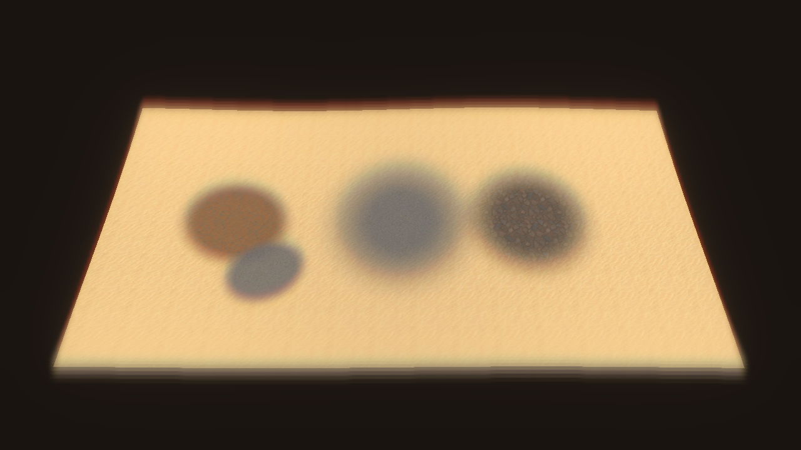

# Ground texture tools — October 9, 2026

Delivered: movable, feathered conforming-mesh stickers and a native terrain texture brush. [Usage and design](../../../Engineering/GROUND_TEXTURE_AUTHORING.md) records controls, persistence, authoring identity, surface/collision boundaries and research sources.

The two overlapping patches on the left are scene-owned stickers. The central gravel area and right rocky area are native alpha-map paint on two synthetic 16 m terrain tiles. The centre brush crosses their common boundary. The reference scene is `Assets/_Project/Scenes/Reference/TextureAuthoringDemo.unity`; it contains two native TerrainData assets, two stickers, a light and camera, and is excluded from enabled Build Settings. Its finer demo alpha-map resolution does not change Greater Wasteland's roughly 2 m paint pixels.

## Proof

- [Six passing focused EditMode tests](focused-tests-2026-10-09.xml): seam-adjacent paint weights, UNorm8 normalization, preserved heights/holes, full-stroke Undo, layer restoration, no-op/hole/disabled-ground cases, sticker sample serialization, stable duplicate identity, no sticker collider, saved demo references and build exclusion.
- [Candidate verification](verification-2026-10-09.json): exact validated source hashes, Unity version, isolation path and proof limits.
- [Direct3D render proof](render-proof-2026-10-09.json): three warmed lighting variants, two painted fixture tiles, two stickers and unchanged fixture heights. The final image was captured with the demo opened alone; an earlier additive-host capture was rejected because host geometry and sunlight contaminated it.
- The source Unity Editor imported the tools without C# compilation failure or sticker-shader compiler messages. The existing rock study remained open and clean. No Play Mode, gameplay smoke test, foreground activation or production painting ran.

The first test pass exposed independent alpha-channel rounding above a total weight of one. Largest-remainder byte packing corrected the implementation; the normalization assertion was retained. A duplication fixture initially attempted additive scene creation against an unsaved untitled test host; it now uses an isolated preview scene and the same scene-scoped ID repair helper. Undo covers TerrainData layer assignments and its existing alpha textures, recorded once per touched tile per stroke.

## Limits

The stickers are lit alpha-blended ground overlays, not URP projected decals or physical displacement. Their finite sample mesh approximates surface contact; they clip invalid cells but cannot guarantee sub-grid hole/relief coverage. Many overlapping transparent patches can be expensive. Native paint modifies TerrainData texture weights/layer assignments and therefore its file hash, while preserving terrain height/collision. Existing baseline receipts are not rewritten by this delivery.

Existing renderer effects, including blur, affect the screenshot. It proves visible authoring output, not accepted final art, brush feel, every shader keyword/platform combination or Player frame-time performance. Starter source textures/import settings, package versions, renderer settings and production terrain were not retuned.
