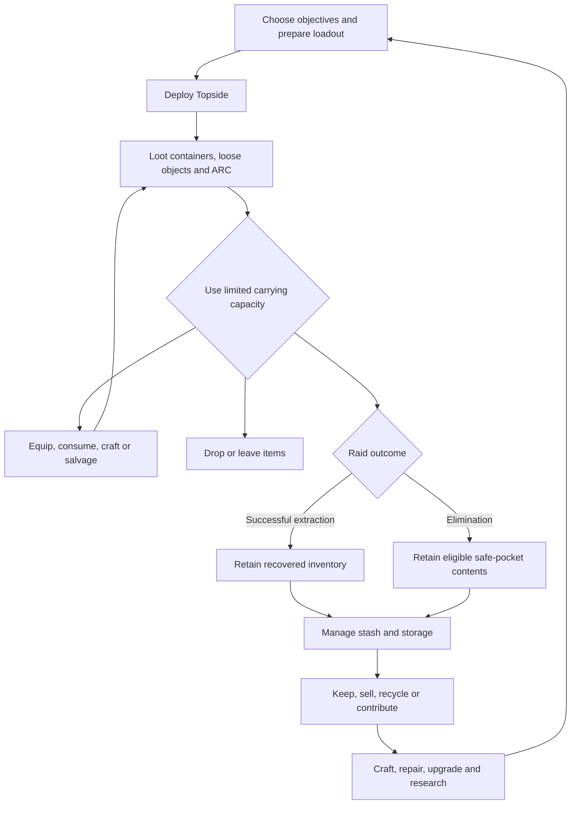

# ARC Raiders item management and crafting audit

Research cutoff: October 15, 2026, America/Phoenix. Current release baseline: 2.1.0, released October 13, following Frozen Trail 2.0 on October 8. Status: external reference research, not Arc & Dust design approval or implementation.

ARC Raiders makes inventory and crafting part of its extraction economy. Carrying limits govern what a player can recover; recipes, facilities, research, and specific scavenged objects govern what that recovery can become. Gear then returns to the surface, where use, consumption, breakage, and loss create replacement demand. The October 2026 Outpost adds furniture storage and another progression layer, so launch-only descriptions omit substantial current behavior.

This audit covers the publicly documented system, representative checked recipes, interaction flows, economic relationships, and evidence conflicts. It does not claim access to Embark's backend, undisclosed loot probabilities, or hands-on verification of every interface state. Those limits matter: no public-source audit can honestly establish literally every internal rule of a changing online game. The [source register](./arc-raiders-item-crafting-sources-2026-10-15.json) records the evidence used, and the final sections identify remaining verification work.

## Current rules and historical changes

The [official news index](https://arcraiders.com/news) and [2.1.0 notes](https://arcraiders.com/news/store-update-2-1-0) establish the release baseline. Several widely repeated descriptions need qualification:

| Older description | Position at the research cutoff |
| --- | --- |
| The ordinary stash stops at 280 slots. | Two additional purchase tiers bring the ordinary maximum to 328, excluding Expedition and Nomadic Envoy space. |
| All workshops stop at level III. | Gunsmith IV and the Research Station belong to the Outpost progression. |
| Blueprints depend entirely on random finds. | Research introduces a directed route for a selection of blueprints; it does not establish that every recipe is researchable. |
| Field dismantling always returns inferior results. | Road Warrior advertises full-efficiency in-round recycling. |
| Weapons stop at IV. | Fifteen weapons gained amplification, a fifth quality level with branching modifications. |
| Cred buys Raider Deck rewards. | Reward Points and Reward Passes replace that system. |
| Expedition is an immediately available recurring reset. | The fifth window closed September 29; further Expeditions are paused until early 2027. |

Sources: [Frozen Trail release notes](https://arcraiders.com/news/frozen-trail-2-0-update), [Frozen Trail preview](https://arcraiders.com/news/frozen-trail-content-preview), [current skill descriptions](https://arcraiders.wiki/wiki/Skills), [Reward Pass explanation](https://arcraiders.com/news/frozen-trail-reward-pass), and [fifth Expedition announcement](https://arcraiders.com/news/the-5th-expedition). Community transcriptions provide some detailed rules; they are distinguished below from developer confirmation.

## The item lifecycle

The developer's [game overview](https://arcraiders.com/news/everything-you-need-to-know) connects scavenging, extraction, traders, workshop improvements, and redeployment. It also identifies free loadouts and Scrappy as ways to recover from running short of equipment.

The diagram is a synthesis of the documented systems, not a statement about server transaction order. A downed state is distinct from final elimination: reviving or extracting while downed must not be confused with an immediate inventory wipe.

## Inventory spaces and carrying limits

The [Gearing up help article](https://id.embark.games/arc-raiders/support/faq/140-gearing-up) describes weapons, shields, ammunition, attachments, gadgets, utilities, and augments. Augments change backpack layout and capacity. Cosmetic backpack appearance should therefore not be treated as proof of carrying capacity.

| Space | Function | Management consequence |
| --- | --- | --- |
| Stash | Persistent home inventory | Capacity is purchased and supplemented through other systems. |
| General backpack slots | Carry extracted targets, spare gear, and materials | An occupied slot and carried mass are separate constraints. |
| Weapon slots | Ready weapons | A weapon carried as loot is not equivalent to an equipped weapon. |
| Quick-use slots | Accessible healing, explosives, and utilities | Access depends on slot assignment as well as possession. |
| Specialized augment slots | Accept specified categories | Extra category slots do not equal unrestricted backpack slots. |
| Safe pockets | Preserve eligible contents through death | Eligibility and available pocket count matter. |
| Outpost furniture attachments | Store/display compatible items | These have their own eligibility and retrieval flow. |
| Expedition Vault | Carries selected objects across an Expedition | Historically purchased separately; not ordinary raid death protection. |

Community [augment tables](https://arcraiders.wiki/wiki/Augments) show that augments jointly set weight limit, general slots, quick-use slots, protected slots, specialized slots, shield compatibility, and perks. They also report that augments cannot be exchanged Topside. Choosing an augment is consequently a pre-deployment commitment, rather than a backpack upgrade that can always be swapped mid-raid.

For scale, the [free-loadout documentation](https://arcraiders.wiki/wiki/Loadout) lists 14 backpack slots, four quick-use slots, two weapon slots, a 35-weight limit, light-shield compatibility, and no safe pocket. A custom loadout can be more capable but puts player-owned supplies at risk. Availability of free loadouts can be restricted by map condition; the June developer notes describe an explicitly temporary restriction, so their exact condition list should not be assumed permanent.

Capacity has several interacting costs. A player can fill slots with light objects while remaining under the mass limit, or become encumbered while slots remain. Reserving space for loot competes with bringing ammunition and escape tools. The 2.1.0 patch specifically fixes carry-weight calculations and Broad Shoulders activation; that is evidence that skill effects belong in the capacity calculation. [Official 2.1.0 fixes](https://arcraiders.com/news/store-update-2-1-0).

## Safe pockets and loss protection

Safe pockets preserve selected eligible items if the raid ends in death. They do not automatically protect everything rare, equipped, or quest-related. A blueprint in an ordinary backpack remains an object at risk until secured or brought home; learning the recipe is a later operation.

The Safekeeper augment is a significant exception to ordinary pocket eligibility: its description permits any item, including a weapon, in its protected pocket. The developer explicitly fixed weapons entering protected pockets without that augment and a Snap Hook entering one while in use. Those fixes establish that eligibility and active use are real rules, not merely UI suggestions. [Official 1.18.0 notes](https://arcraiders.com/news/patch-notes-1-18-0); [Safekeeper item record](https://arcraiders.wiki/wiki/Looting_Mk._3_%28Safekeeper%29).

Do not describe safe pockets as insurance on the whole loadout. They create a small protected allocation problem: a player may need to choose between a recipe unlock, rare progression component, or escape key. The value of the pocket is often the progression it preserves rather than the object's sale price. This is a design inference from the documented loss and recipe systems.

## Looting and field inventory interactions

The community [Game UI reference](https://arcraiders.wiki/wiki/Game_UI) documents a container pane beside inventory, plus weapon swaps, quick-use assignment, safe-pocket transfers, splitting stacks, and dropping objects. It describes a quick-use radial that can expose slots without individual shortcut keys. Its skill-unlock details predate Frozen Trail and should not control a current build guide.

Searching is itself part of play. Current skill descriptions distinguish faster item reveal, quieter searching, and chances to reveal multiple items together. Inventory decisions therefore involve exposure time as well as capacity. Looting a container is not simply a safe, instantaneous transfer of all its contents.

The [1.2.0 notes](https://arcraiders.com/news/north-line-patch-notes) added a split-stack action and kept field-crafting selection on the same recipe after a craft. Frozen Trail permits dropping loot directly from containers. These details show support for partial acquisition, repeated crafting, and leaving items for someone else without first packing them.

Loot availability is contextual. Blueprint distribution varies by container family, map, and condition; a general farming rule is not a guarantee for a specific recipe. The developer also tests Dynamic Loot Zones on Pendola Pass: value changes between raids while a zone retains its underlying loot type. The distinction matters for route planning: a residential district does not randomly become an industrial loot category. [Blueprint distribution reference](https://arcraiders.wiki/wiki/Blueprints); [Frozen Trail notes](https://arcraiders.com/news/frozen-trail-2-0-update).

## Stash capacity and housekeeping

The [Speranza stash table](https://arcraiders.wiki/wiki/Stash) starts at 64 slots. Successive capacities are 88, 112, 136, 160, 184, 208, 232, 256, 280, 304, and 328. The corresponding purchase prices are 5,000; 10,000; 15,000; 25,000; 40,000; 60,000; 90,000; 130,000; 300,000; 750,000; and 1,500,000 Coins. Its cumulative total is 2,925,000 Coins. These prices are community-transcribed; the developer confirms the 328 ordinary maximum, rather than this complete cost table.

That same wiki page illustrates documentation drift: its prose still says 280 even though its table includes 328. Use the current developer cap and label the table appropriately.

The stash supports stack merging and unloading backpack contents. Merging reduces wasted slots caused by partially filled stacks; it cannot increase an item's stack limit. The [1.33.0 update](https://arcraiders.com/news/live-update-1-33-0) explicitly fixed merging with overflow and added shortcuts for Sell, Recycle, Repair on gamepad, Salvage, and Drop. It also changed free-loadout selection so the current loadout is not cleared until a round is played.

Stack limits differ by object. The checked [Light Ammo record](https://arcraiders.wiki/wiki/Light_Ammo) lists a stack of 100, whereas [Bandage](https://arcraiders.wiki/wiki/Bandage) lists five. The number of distinct stacks, not just the quantity of units, determines storage pressure.

Overflow is an actual UI state, not established evidence that excess items are deleted. Conversely, it is not unlimited usable storage. The developer has patched specific overflow exceptions and interactions, including seed purchases, free-loadout augments, and mod detachment. Exact restrictions on crafting, buying, reward claiming, and deployment while overflowing remain a current-client verification gap. [Shrouded Sky notes](https://arcraiders.com/news/shrouded-sky-patch-notes-1-17-0); [Flashpoint notes](https://arcraiders.com/news/patch-notes-1-22-0).

## Item categories and competing uses

The [item catalogue](https://arcraiders.wiki/wiki/Items) distinguishes equipment, basic and refined materials, Topside materials, recyclables, nature items, trinkets, and other objects. Its important lesson is the network of uses: the same object can have crafting, repair, facility, quest, and project demand. A generic sell-or-recycle rule based only on rarity loses that context.

For decision-making, classify an item by its available transformations:

| Item role | Decisions it creates |
| --- | --- |
| Ready equipment | Deploy, keep as replacement, modify, repair, sell, or dismantle. |
| General material | Spend now or reserve for several possible recipes. |
| Specific scavenged component | Preserve for a named gate or break down for immediate needs. |
| Recipe/design/stencil object | Learn if missing, or retain a duplicate for another permitted use. |
| Research object | Study for points or preserve for a station upgrade that needs the intact object. |
| Quest/project requirement | Hand in only against the intended objective. |
| Collectible/trinket | Sell, display, or satisfy a specific current requirement. |
| Access item | Spend capacity now to gain a future route, room, or extraction opportunity. |

These are analytical roles, not a replacement for the game's category names. They explain why an apparently disposable household object can be worth more to a particular player than a higher-rarity weapon.

## Workshop structure and crafting gates

Embark's [progression article](https://id.embark.games/arc-raiders/support/faq/139-game-progression-1759329960) identifies six specialized crafting tables. The basic Workbench and new Research Station need to be counted separately from those six.

| Facility | Main function |
| --- | --- |
| Workbench | Starting survival equipment and ammunition. |
| Gunsmith | Weapon and attachment production; weapon improvements. |
| Gear Bench | Shields and augments. |
| Medical Lab | Healing and medical supplies. |
| Explosives Station | Grenades, mines, and explosive utilities. |
| Utility Station | Traversal, concealment, distraction, and other tools. |
| Refiner | Intermediate parts and advanced material conversion. |
| Research Station | Blueprint/design acquisition and amplification research. |

The [Workshop table](https://arcraiders.wiki/wiki/Workshop) documents material costs to construct and improve stations. Most traditional specialists reach III; Gunsmith reaches IV with Outpost progression. Examples of upgrade gates include Rusted Tools and Wasp Drivers for Gunsmith II, a Cracked Bioscanner and Tick Pods for Medical Lab II, and Toasters and Fireball Burners for Refiner II. These deliberately mix ordinary salvage, refined components, and enemy parts.

A useful synthesis is that making a particular object requires the appropriate context, a known/default recipe, the required facility tier or skill, sufficient ingredients, and room for the result. Having the blueprint alone does not satisfy the facility or material requirements. Having ingredients alone does not teach a locked recipe.

Recipes are fixed input/output transformations, sometimes producing a batch. The evidence supports menu-based production and quantity management; it does not establish a factory simulation, fuel system, production automation, or an offline crafting queue. Exact current timers and bulk-command behavior should be measured in the client before making timing claims.

## Blueprint knowledge and directed research

According to the [Blueprints reference](https://arcraiders.wiki/wiki/Blueprints), a blueprint is a physical item until the player chooses **Learn and Consume** in Speranza. Learning destroys that copy and unlocks its recipe. Known duplicates show a check mark and cannot be consumed again; the table lists a 5,000-Coin sale value. Acquisition includes scavenging, quests, Trials, and projects, with item-specific restrictions.

There are three distinct states: finding a usable weapon, owning a blueprint object, and knowing a repeatable production recipe. None implies the other two. Buying or receiving equipment can let someone use an item before they can manufacture replacements. Learning a recipe improves repeatability but does not make ingredients unlimited.

The Outpost's Research Station adds a directed acquisition path. Developer interview reporting identifies a selection of researchable blueprints, including the new weapons, rather than a universal replacement for blueprint drops. [Developer interview at GamesRadar](https://www.gamesradar.com/games/third-person-shooter/arc-raiders-will-finally-let-players-unlock-weapons-and-items-without-hunting-down-blueprints/).

One catalogue example prices an Angled Grip II Blueprint at 3,000 Research Points, five ARC Flex Rubber, and one Mechanical Component at Research Station II. That is a recipe for a blueprint object, not the finished attachment. The [Research Points table](https://arcraiders.wiki/wiki/Research_Points) also lists research routes for weapons, equipment, parts, and utilities. Verify whether a particular research result requires the normal Learn and Consume step; the public material does not prove every research UI uses identical semantics.

## Crafting workflow and resource acquisition

The player's practical workshop sequence is to choose a recipe, inspect requirements and quantities, resolve missing unlocks or ingredients, craft the output, and include it in the intended loadout. Repeated outputs and batch yields make the desired final quantity more useful than a bare count of button presses.

The strongest documented UX change is **Acquire Resources**. Embark describes opening it from a recipe with missing materials, seeing currently available sources, and using those sources immediately. It is an availability-aware list, not a promise that every missing resource can be bought. [Reducing friction in ARC Raiders](https://arcraiders.com/news/user-experience-improvements).

Flashpoint explicitly makes recycling, refining, and purchasing available in the crafting window. This joins several formerly separate management steps around a player's intended result. [Official Flashpoint notes](https://arcraiders.com/news/patch-notes-1-22-0). A later update prioritizes crafting suggestions over recycling suggestions, showing that the ordering of alternative routes is also a design concern. [Riven Tides notes](https://arcraiders.com/it/news/riven-tides-patch-notes-1-26-0).

Tracking supplies helps players turn a recipe or project into a shopping list. The 2.1.0 notes fix Outpost module recipes remaining tracked after installation, establishing that completed requirements are meant to clear appropriately. Tracking should not be confused with reserving or protecting those resources from every other transaction. Exact aggregation and reservation behavior remain unverified.

## Refining and checked recipe examples

These are selected community-transcribed recipes checked during the audit. They explain the system's different gates and yields; they are not a complete patch-locked recipe database.

| Result | Inputs | Gate | What it demonstrates |
| --- | --- | --- | --- |
| 1 Bandage | 5 Fabric | Workbench I or Medical Lab I; field skill route also listed | Simple emergency conversion. |
| 25 Light Ammo | 3 Metal Parts + 2 Chemicals | Workbench I | Output quantity differs from craft count. |
| 1 Mechanical Component | 7 Metal Parts + 3 Rubber Parts | Refiner I | Basic materials become intermediates. |
| 1 Advanced Mechanical Component | 2 Steel Springs + 2 Mechanical Components | Refiner II | A deeper chain still needs specific scavenged inputs. |
| 1 Wolfpack | 1 Explosive Compound + 2 ARC Motion Cores + 1 Rocketeer Driver | Explosives Station III + learned blueprint | Late equipment requires knowledge, facility, and enemy salvage. |
| 1 Raider Hatch Key | 1 Advanced Electrical Component + 3 Sensors | Utility Station II or Traveling Tinkerer field route | Crafting can purchase an extraction option. |

Individual sources: [Bandage](https://arcraiders.wiki/wiki/Bandage), [Light Ammo](https://arcraiders.wiki/wiki/Light_Ammo), [Mechanical Components](https://arcraiders.wiki/wiki/Mechanical_Components), [Advanced Mechanical Components](https://arcraiders.wiki/wiki/Advanced_Mechanical_Components), [Wolfpack](https://arcraiders.wiki/wiki/Wolfpack), and [Raider Hatch Key](https://arcraiders.wiki/wiki/Raider_Hatch_Key). The key page compresses requirements into one row; its wording should not be used to assert that the field skill is also mandatory for the workshop route.

The advanced mechanical chain expands to 14 Metal Parts, six Rubber Parts, and two Steel Springs if both intermediates are manufactured from scratch. This is arithmetic from those two checked recipes. Recovering a finished intermediate avoids that particular conversion cost, but may incur a different acquisition cost.

Crafting and dismantling are not inverse operations. A Bandage made from five Fabric returns two through home recycling or one through ordinary field salvage. The difference removes material from circulation. Light Ammo cannot be recycled or salvaged. Neither universal reversibility nor a universal return percentage is supported by these examples.

## Field crafting and field repair

Embark documents a Crafting tab inside the field inventory, including a filter for recipes possible with the materials currently carried. It also documents breaking items down directly from their action menu. Home stash contents are not a remote supply pool for a raid. [Official field-crafting help](https://id.embark.games/arc-raiders/support/faq/141-field-crafting-1759329975); [field UI reference](https://arcraiders.wiki/wiki/Game_UI).

The current [skill transcription](https://arcraiders.wiki/wiki/Skills) lists these relevant routes:

- **In-round Crafting:** Flame Spray, Shaker, Li'l Smoke Grenade, Light Impact Grenade, Fruit Mix, Shield Recharger, Adrenaline Shot, Agave Juice, and Bandage.
- **Traveling Tinkerer:** Noisemaker, four grenade traps, Herbal Bandage, and Raider Hatch Key.
- **Nomadic Crafting:** Heavy, Light, Medium, and Shotgun Ammo; Shrapnel Grenade, Defibrillator, and Zipline.
- **Road Warrior:** additional ARC ammunition/Powercell loot and full-efficiency field recycling.
- **Field Repair:** weapons, shields, and gadgets can be repaired up to 30% durability during a round.

The reworked Survival branch makes a meaningful late choice: the three final options allow only two selections. Field flexibility, efficient material recovery, and emergency equipment maintenance cannot all be assumed available on one build. Exact node prerequisites should follow the current tree, not older level-two unlock walkthroughs.

The 2.1.0 patch fixes Field Repair activation, Field Salvaging item display, and interrupted field-action camera behavior. Thus October 8 videos can show faults already addressed by October 13. [Official 2.1.0 notes](https://arcraiders.com/news/store-update-2-1-0).

Strategically, field crafting converts carried materials into immediate survivability or escape options. It also delays commitment: ingredients can retain several possible uses until the player chooses an output. That flexibility competes with the weight, slots, and time required to carry and transform them.

## Recycling, salvaging, and selling

Home recycling and field salvaging need separate output records. The [recycling database](https://ardb.tools/recycling) explicitly warns that field salvage may return fewer or different materials. The official help article uses the broader term Field Recycling, so terminology alone does not establish equal yields. Road Warrior is a current skill exception to the ordinary efficiency difference.

Selling converts an object to Coins; recycling converts it to other objects. The result can be worse for sale value yet useful for a missing ingredient. The database's comparison columns make this distinction visible. The 1.17.0 patch also reduced ARC-part sale values to better reflect crafting and progression uses. [Official Shrouded Sky notes](https://arcraiders.com/news/shrouded-sky-patch-notes-1-17-0).

For a specific choice, compare intact hand-in demand, usable equipment value, replacement difficulty, recycling outputs, output space, and immediate cash needs. Recycling an upgrade component before checking its intact use can destroy a scarce progression gate. Recycling can also increase occupied slots when several output types cannot join existing stacks.

A simple analytical rule for space is `net slots freed = occupied input stacks removed - additional output stacks needed`. For batch production with yield `y`, the required craft count is `ceil(desired units / y)`, adjusted for units already owned. These are accounting tools, not claimed game algorithms. The same reasoning explains why pre-crafting everything is not automatically optimal: outputs can stack less efficiently and reduce future recipe flexibility.

## Weapons, modifications, and maintenance

The [weapon reference](https://arcraiders.wiki/wiki/Weapons) separates permanent improvements from removable attachments. Normal names I through IV identify upgrade level; those numerals should not be confused with the weapon's rarity color. Weapon-specific improvements vary. Attachments require compatible slots and can be exchanged separately.

Embark documents weapon degradation and resource-based repair from Inventory, More Actions, Repair. The repair material varies by weapon. [Official Gearing up help](https://id.embark.games/arc-raiders/support/faq/140-gearing-up). Repair and crafting compete for the same economy, even though one preserves an existing object while the other creates one.

A weapon instance can therefore carry an upgrade level, durability, attachments, and a stencil, in addition to its base identity. Selling or losing that instance concerns more than the base gun. Another Raider can loot a stenciled weapon with its stencil. [Stencil reference](https://arcraiders.wiki/wiki/Weapon_Stencils); [developer preview](https://arcraiders.com/news/frozen-trail-content-preview). Applying learned stencils uses Stencil Parts. [Official stencil requirements](https://arcraiders.com/news/frozen-trail-2-0-update).

Riven Tides introduced a weapon repair benefit on upgrading equal to 25% of maximum durability. It also adjusted spawned weapon condition and durability consumption to address accumulation and upkeep; May's 1.29.0 update subsequently increased lifetime for weapons that wore out too quickly. These dated changes show maintenance being tuned as part of the economy. [Official Riven Tides economy changes](https://arcraiders.com/it/news/riven-tides-patch-notes-1-26-0); [1.29.0 durability adjustments](https://arcraiders.com/news/patch-notes-1-29-0). Exact current repair rounding, minimum costs, and attachment handling during dismantling still need client checks. A weapon-specific upgrade benefit should not be generalized to every category of equipment.

## Outpost furniture and storage

The Outpost is unlocked through a project and expanded with modules. Furniture Designs unlock repeatable furniture construction, while the Research Station opens another progression service. The official release lists 100 furniture designs with several acquisition routes. [Official Frozen Trail notes](https://arcraiders.com/news/frozen-trail-2-0-update); [Outpost preview](https://arcraiders.com/news/frozen-trail-content-preview).

The [Outpost reference](https://arcraiders.wiki/wiki/Outpost) names the unlock project Sheltered Retreat and ties Research Station levels to Outpost levels. Its station table includes Research I requiring three Mini Pumps, 35 Planks, and five Battered Paperbacks; Research IV requires three Thermal Shakers, three ARC Data Modules, and a Frigate Inductor. These are community-transcribed gates, not an official complete cost specification.

Furniture adds usable storage as well as decoration. A hands-on [PC Gamer furniture guide](https://www.pcgamer.com/games/third-person-shooter/dont-neglect-crafting-furniture-in-your-arc-raiders-outpost-it-unlocks-100s-of-extra-storage-slots/) describes listed attachment slots, the Decorate command, whole compatible stacks, weapon racks, and Clear All Attached Items to return contents to stash. This is a distinct storage interface, rather than an unconditional increase to the ordinary stash counter.

The [furniture table](https://arcraiders.wiki/wiki/Furniture) lists three attached slots for a Battered Weapon Rack and four for a Sturdy Weapon Rack. Compatibility still matters: a display slot cannot be assumed to accept every component. Community reports also describe storing filled racks as furniture, but this audit does not treat the resulting maximum capacity, persistence, or intended status as verified.

Furniture changes the economic role of collectibles: displaying compatible objects can preserve them while freeing ordinary storage. It also adds retrieval work. Whether attached resources remain available to crafting, quests, and valuation should be checked per interface before treating this storage as interchangeable with stash.

## Research and amplified weapons

The developer [Frozen Trail preview](https://arcraiders.com/news/frozen-trail-content-preview) describes a fully upgraded Research Workstation enabling a fifth quality level for 15 weapons. Branches can substantially change behavior, with examples including a fully automatic Burletta, a scoped Renegade, and an incendiary Rattler. This is a separate system from normal removable weapon attachments.

The [screenshot-backed amplification study](https://arcraidershub.com/guides/amplified-weapons-guide) describes a sequence of Outpost IV, Gunsmith IV, a level-IV eligible weapon, and an appropriate Amplification Module. It distinguishes one-time research from subsequent spending on a particular gun. Research can require raid tasks followed by Research Points and ARC parts; up to five projects can be active. Its example of Embedded Blast Engineering requires damage tasks, then 5,000 Research Points and five Rocketeer Drivers. Upgrades on an individual weapon cost additional materials.

That study also describes consuming research items for points, irreversible branch choices on a weapon, and specialized repair demand. These details are useful but include early-access and community observations; universal claims about looted amplified durability are particularly weak. The same article says roughly 10–11 durability while showing a 9/200 example. Do not encode that as an exact fixed drop rule.

The official 2.1.0 patch corrects Mobile-Fire Grip Fittings to require Skulker Targeters, rather than Skulker Drivers, and adds highlighting along an amplification path. The official 2.0 notes identify Amplified Fragments as repair inputs and turn the retired Anvil Splitter into a recyclable source of them. [2.1.0 corrections](https://arcraiders.com/news/store-update-2-1-0); [2.0 weapon changes](https://arcraiders.com/news/frozen-trail-2-0-update).

The design consequence is a layered gate: recover special technology, develop facilities, earn reusable knowledge, invest in a weapon instance, and maintain that instance. Looting an advanced gun does not by itself establish the ability to reproduce or economically sustain it.

## Traders, currencies, and alternate acquisition

The [trader reference](https://arcraiders.wiki/wiki/Traders) distinguishes Celeste's material barter, Tian Wen's weapons/ammunition/mods, Lance's equipment and medical services, Apollo's gadgets/explosives, Shani's offers, and the Nomadic Envoys. Trader and crafted acquisition coexist; a learned recipe is not the only route to every usable item.

The [Nomadic Envoy announcement](https://arcraiders.com/news/meet-the-new-trader) describes a level-25 service exchanging gear and specific materials for rotating offers, blueprints, stash expansion, and an Expedition Vault. Its intended role includes draining hoarded equipment. The vault has five slots to carry selected items across a reset; it does not automatically preserve all previously learned recipes.

Frozen Trail replaces Ermal with Cassio, changes Shani's offers to Coins, moves Anvil and Hullcracker offers into the weekly Envoy rotation, and imposes daily purchase limits on Launcher Ammo and Energy Clips. Thus older claims about a trader selling a gun or unlimited ammunition should be checked against the current offer. [Official trader changes](https://arcraiders.com/news/frozen-trail-2-0-update).

Coins, Assorted Seeds, Research Points, Reward Points, and Raider Tokens serve different purposes. Seeds can buy material access; research points buy knowledge; Reward Points advance the selected pass; Tokens access commercial/cosmetic content. The developer's [Reward Pass explanation](https://arcraiders.com/news/frozen-trail-reward-pass) says the Free track includes gameplay equipment, while the Premium track does not include gameplay-benefiting weapons or gadgets. It separately identifies a DLC-exclusive Banjo blueprint, so an absolute claim that all craftable objects have identical acquisition access would be inaccurate.

## Scrappy and economic recovery

Scrappy collects materials while the player raids, and training expands that support. The official [progression help](https://id.embark.games/arc-raiders/support/faq/139-game-progression-1759329960) establishes the basic role. Free loadouts supply a second recovery path; Embark explicitly calls them a safety net for the player's personal economy. [Flashpoint explanation](https://arcraiders.com/news/patch-notes-1-22-0).

The [Scrappy reference](https://arcraiders.wiki/wiki/Scrappy) reports collection scaling with training, time spent in the round, and outcome, with a collection limit after five rounds. It also describes a six-item food queue: after at least six minutes in a round, food can generate additional materials and a chance of more valuable outputs. Listed training targets progress through a Dog Collar, fruit, a Cat Bed, mushrooms, and Very Comfortable Pillows. Exact yield tables are community observations; they should not be confused with guaranteed rare-item probabilities.

This gives ordinary nature and household loot recurring utility beyond direct sale. It also softens failure: an unsuccessful raid can still contribute XP, knowledge, or recovery materials, even though unsecured loot is lost. This is an economic interpretation, not a claim that every objective survives every failed extraction.

## Quests, projects, and Expedition resets

Quests and projects consume or reward items, so they compete with immediate crafting. Their requirements are not interchangeable: an objective to damage an enemy, recover an object, extract with it, photograph something, or donate a quantity describes different state transitions. Flashpoint's progress bars indicate progress that may be lost on extraction failure; the current client should remain authoritative per objective. [Official Flashpoint notes](https://arcraiders.com/news/patch-notes-1-22-0).

Historically, Expedition is a voluntary character reset rather than a compulsory global wipe. The developer's [original Expedition explanation](https://arcraiders.com/news/expedition-project) distinguishes lost character progression, inventory, workshop, and crafting capabilities from retained cosmetics, achievements, and other account progression. This explains why a learned recipe should not be described as unconditionally permanent across every reset. Subsequent vault, quest-reset, and scheduling changes qualify that original design; the 2025 timing and benefit proposals are not the current rules.

The [fifth Expedition announcement](https://arcraiders.com/news/the-5th-expedition) distinguishes Caravan completion from explicit sign-up, makes quest reset optional, awards 12 stash slots per completion up to 60, and pauses future departures until early 2027. Consecutive buffs persist during that pause, and partially completed Caravans are replaced with vouchers. At this cutoff it is misleading to recommend donating to an ordinary ongoing Caravan without checking the current interface.

The [May 1.29.0 notes](https://arcraiders.com/news/patch-notes-1-29-0) describe Envoy-purchased stash expansion as reset on departure and introduce the five-item Expedition Vault. This makes storage persistence a property of the storage source, not a single global permanent-capacity rule. Historical reset instructions need their date and exception set attached.

## Current matchmaking affects the loot economy

The October 13–20 PvE toggle is a beta test at this cutoff. Embark says PvE servers have lower overall loot value and exclude several major conditions, including Frigate and Redirection. [Official beta explanation](https://arcraiders.com/news/pve-toggle-what-to-know). This directly matters to advanced progression because some inputs are linked to those activities. It does not prove that no alternative route to any particular advanced material exists.

The audit should therefore distinguish a rule of crafting from a temporary rule of acquisition. Recipe knowledge may be unchanged while access to its inputs varies by mode, event, map condition, or trader rotation.

## System strengths and friction

The following are design interpretations of the documented mechanics, not measured usability or retention results.

| Pattern | What it accomplishes | Cost or risk |
| --- | --- | --- |
| Slots plus mass | Makes the extraction haul a choice about composition and mobility. | Players must understand two different capacity limits. |
| Limited safe pockets | Preserves selected progress through failure. | Item eligibility and exceptions must be legible. |
| Shared ingredients | Makes salvage useful to several future plans. | A routine craft can consume a hard-to-replace upgrade input. |
| Specific intact-object gates | Turns world knowledge into purposeful scavenging. | Low drop rates can halt otherwise ready progression. |
| Recipe plus facility gates | Separates knowing an item from sustaining its manufacture. | Several simultaneous blockers can feel opaque. |
| Resource acquisition inside crafting | Keeps attention on the desired result. | Proposed recycling donors still need clear consequences. |
| Reversible attachments and permanent upgrades | Supports both experimentation and investment. | Different permanence rules can be confused. |
| Research and amplification | Adds directed and instance-specific late progression. | More currencies, components, tasks, and upkeep increase planning burden. |
| Furniture storage | Gives collections a physical home and relieves stash pressure. | Category restrictions and retrieval add management steps. |
| Free kits and Scrappy | Provides routes back into play after losses. | Recovery generosity must coexist with reasons to risk owned gear. |

Embark's own friction article confirms that excessive crafting-menu work was a player pain point. It does not establish that the new button resolved every cause. The important distinction for comparative design is between a consequential resource choice and repetitive work needed to execute an already-made choice.

## Evidence conflicts and unresolved details

| Question | Evidence and resolution |
| --- | --- |
| 280 or 328 ordinary stash maximum? | Current official 2.0 notes resolve this to 328; older prose is stale. |
| Is every station capped at III? | No. Current workshop and Outpost material includes higher levels. |
| Is field recycling always inferior? | No universal claim: ordinary item tables distinguish salvage, and Road Warrior advertises full efficiency. |
| Are recipe unlocks automatic on pickup or extraction? | No. Blueprint documentation explicitly requires Learn and Consume at home. Research-result behavior needs a separate check. |
| Does a gun upgrade change its rarity color? | I–IV are upgrade levels. Do not infer a rarity ladder from those numerals. |
| Is amplification purely a branch unlock with no stat changes? | Developer descriptions emphasize changed behavior; individual community screenshots also report durability/stat changes. Avoid an absolute no-stat claim. |
| Do looted amplified guns always have exactly ten durability? | Unproven; the detailed guide itself shows a nine-durability counterexample. |
| Can every material be bought from the recipe screen? | No. Acquire Resources only shows currently available sources. |
| Does furniture provide hundreds of unrestricted stash slots? | No such equivalence is established. It stores compatible attached items in another interface. |
| What are the exact October trader quantities, research catalogue, and all recipe costs? | No complete official current data export was located. Item pages and offer screens must be checked individually. |
| Are old dates or last-modified labels sufficient proof? | No. Wiki templates can update embedded data while an article's displayed edit date remains old. Version tags require care. |

The full lock/protect-item feature set, favorites, sort persistence, full-stash transaction matrix, reward-inbox expiry, current loot return rules after disconnects, and exact controller/keyboard sequences remain outside verified coverage. The existence of action shortcuts is documented; their exact default bindings can change and can be rebound.

Public sources also do not establish authoritative backend transaction behavior, duplication protection implementation, rollback rules, exact drop probabilities, or the formula balancing loot against matchmaking. Those are not necessary to explain the visible loop, but they prevent an honest claim to know every internal detail.

## Verification needed for a literal current-client audit

This is a bounded follow-up protocol, not gameplay testing performed during this task:

1. Record the exact build and account progression, then capture each home inventory, station, recipe, research, trader, and Outpost state.
2. Exercise split, merge, unload, partial transfer, equipment compatibility, safe-pocket eligibility, and overflow with before/after quantities.
3. Check each current recipe's inputs, yield, unlock, facility level, time, destination, and failure message; compare field and home variants separately.
4. Check one-time research unlocks versus crafted blueprint objects, and research prerequisites versus per-weapon upgrade costs.
5. Test intact-component contribution versus recycling, plus output-space failure and whether tracked ingredients are protected.
6. Compare ordinary field salvage with Road Warrior, field repair below and above 30%, and relevant resource costs.
7. Check furniture eligibility, full stacks, retrieval, dismantling, saved filled racks, crafting access, and stash-value accounting.
8. Verify elimination, revival, successful extraction, disconnect, and compensation separately. Do not conflate an exploit or outage fix with intended ordinary behavior.

For later comparison with Arc & Dust, the transferable research questions are material legibility, capacity, source discovery, recipe blockers, transaction feedback, and recovery after failure. Extraction loss, safe-pocket exceptions, trader rotations, prestige resets, and commercial acquisition are separate product choices. This research does not authorize adopting them or changing the project's item catalogue, crafting routes, terrain, saves, or UI.
